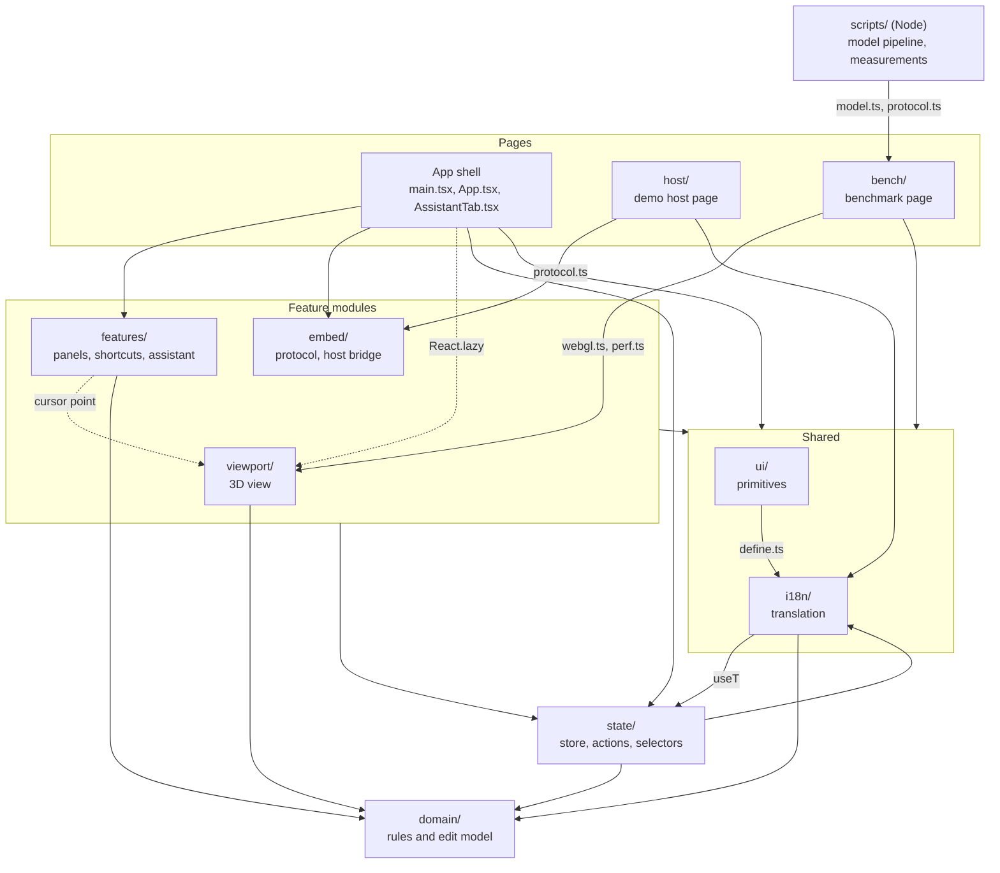
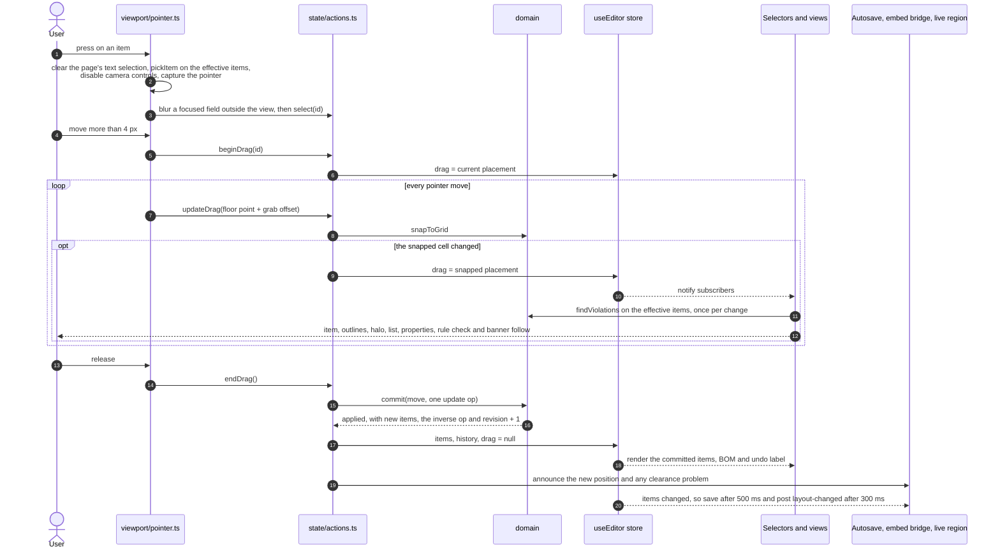
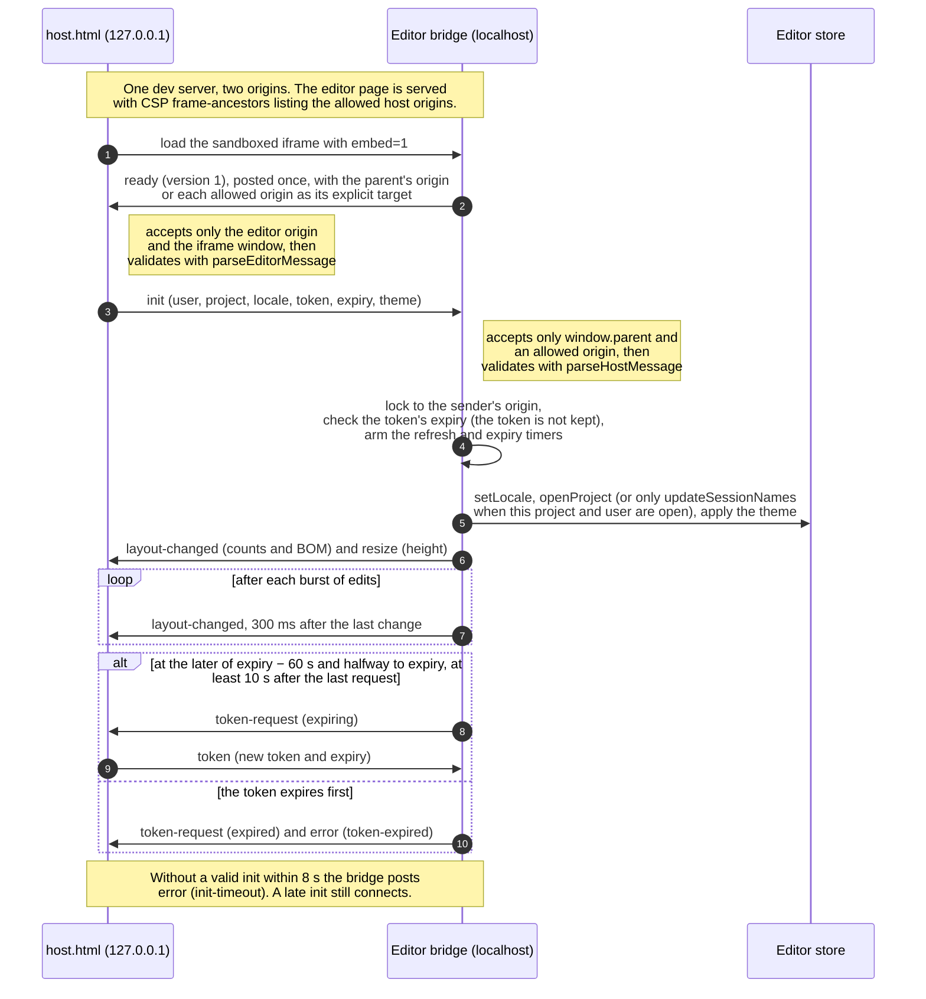

# Editor architecture

How the layout editor in `src/` is built, as of 19 October 2026. This document is written from the code, not from the plans: constants are quoted from the source, and every measurement was taken on that date and says how. [CONTRACTS.md](CONTRACTS.md) holds the working rules for contributors, [PLAN.md](PLAN.md) the plan and its reasoning, and [model-optimisation.md](model-optimisation.md) the separate 3D model pipeline and benchmark page.

## Contents

1. [Overview](#1-overview)
2. [Module map and dependency rules](#2-module-map-and-dependency-rules)
3. [State model](#3-state-model)
4. [Edit model](#4-edit-model)
5. [Data flow of one edit](#5-data-flow-of-one-edit)
6. [Rendering pipeline and draw-call budget](#6-rendering-pipeline-and-draw-call-budget)
7. [Interaction](#7-interaction)
8. [Embedding](#8-embedding)
9. [Assistant](#9-assistant)
10. [Internationalisation](#10-internationalisation)
11. [Accessibility](#11-accessibility)
12. [Testing](#12-testing)
13. [Package choices](#13-package-choices)
14. [Known limits](#14-known-limits)

## 1. Overview

The editor places electrical-room equipment on a 20 m × 12 m floor with a 0.5 m grid. It checks a 0.6 m clearance rule while you edit, derives a bill of materials (BOM), supports undo and redo, runs in English and Vietnamese, can be embedded in another web application on another origin, and includes a simulated assistant that proposes clearance fixes.

| Aspect             | Choice                                                                                                                          |
| ------------------ | ------------------------------------------------------------------------------------------------------------------------------- |
| UI                 | React 19.3 in `StrictMode`, CSS Modules with design tokens                                                                      |
| Language and build | TypeScript 6 (strict), Vite 8 with Rolldown, pnpm 10                                                                            |
| State              | One zustand 5 store for the editor; TanStack Query for the assistant request, loaded with the Assistant tab                     |
| 3D                 | three.js 0.186, React Three Fiber 9.8, drei 10.7                                                                                |
| Pages              | `index.html` (the editor), `host.html` (a demo host that embeds the editor from another origin), `bench.html` (model benchmark) |

Launch options, parsed by `src/config.ts`:

| Parameter         | Effect                                                                                                                                           |
| ----------------- | ------------------------------------------------------------------------------------------------------------------------------------------------ |
| `?seed=N`         | A generated layout with N items, always the same for a given N; autosave off. Any whole number is accepted and values above 2,000 count as 2,000 |
| `?perf=1`         | Performance overlay on, continuous rendering                                                                                                     |
| `?instancing=off` | One mesh per item instead of one instanced mesh per item type                                                                                    |
| `?embed=1`        | Embedded mode: the editor waits for the host's `init` message                                                                                    |

Domain vocabulary used throughout:

- An item is `{ id, kind, tag, x, z, rotation }`. `x` and `z` are the footprint centre in metres from the north-west corner (x points east, z south, y up). `rotation` is 0, 90, 180 or 270 degrees clockwise in plan; at 90 and 270 the footprint swaps width and depth.
- `CATALOG` defines four kinds: switchgear cabinet (tag prefix CAB, 1.0 × 0.5 × 2.0 m), variable frequency drive (VFD, 0.5 × 0.5 × 1.8 m), dry-type transformer (TR, 1.5 × 1.0 × 1.8 m) and UPS (UPS, 1.0 × 1.0 × 1.6 m), each with a part number and a unit price.
- An item is valid when its footprint lies inside the room, its edges lie on the 0.5 m grid, and its tag, after normalisation (section 4.1), is non-empty, at most 24 characters long and unique, ignoring case.
- A clearance violation is a pair of items whose footprints are less than 0.6 m apart at their closest points. Overlaps are reported as overlaps. Clearance is not a validity rule: a layout may break it, and every view reports the violations.

## 2. Module map and dependency rules



Solid arrows are static imports, and an arrow that starts or ends at a group applies to every module in it. The dotted arrow from the shell is the lazy import of the 3D view, and the dotted arrow from `features/` is a narrow exception (rule 5 below). The Assistant tab (`src/AssistantTab.tsx`) and the shortcut dialog's popup are lazy chunks as well (section 6.8). `i18n/` and `state/` depend on each other at folder level only: `useT()` reads the language from the store and actions use the translator, but no file takes part in an import cycle (a script over every non-test file in `src/` found no cycle of value imports on 19 October 2026). Not drawn: type-only imports, and `i18n/messages.ts` importing every module's `messages.ts` to register its strings.

| Module      | Responsibility                                                                                                                                                                                                                                         | Key files                                                                                                                                                                                    | Packages                                                               |
| ----------- | ------------------------------------------------------------------------------------------------------------------------------------------------------------------------------------------------------------------------------------------------------ | -------------------------------------------------------------------------------------------------------------------------------------------------------------------------------------------- | ---------------------------------------------------------------------- |
| `domain/`   | Business rules as pure functions: grid and snapping, ops and validation, transactions and history, the clearance rule with a spatial hash, BOM, tag naming, free-spot search, proposals and the greedy clearance fix, generated layouts, draft parsing | `types.ts`, `catalog.ts`, `grid.ts`, `ops.ts`, `history.ts`, `rules.ts`, `bom.ts`, `naming.ts`, `placement.ts`, `proposal.ts`, `proposeFix.ts`, `seed.ts`, `serialize.ts`                    | `zod/mini` (drafts)                                                    |
| `state/`    | The editor store, every action that changes it, memoised selectors, autosave, startup, the query client factory                                                                                                                                        | `store.ts`, `actions.ts`, `selectors.ts`, `memo.ts`, `persistence.ts`, `bootstrap.ts`, `queryClient.ts`                                                                                      | zustand, Sonner, TanStack Query                                        |
| `i18n/`     | Typed dictionaries, the i18next engine, `Intl` formatters, `useT()`, shared sentences                                                                                                                                                                  | `engine.ts`, `translate.ts`, `useT.ts`, `define.ts`, `messages.ts`, `common.ts`, `describe.ts`, `format.ts`, `locales.ts`                                                                    | i18next                                                                |
| `ui/`       | Design-system primitives                                                                                                                                                                                                                               | `Button.tsx`, `Tooltip.tsx`, `Tabs.tsx`, `Segmented.tsx`, `Switch.tsx`, `Field.tsx`, `Toaster.tsx`, `LiveRegion.tsx`, `StateMessage.tsx`, `Section.tsx`, `keepIndexRendered.ts`, `icons.tsx` | Base UI, Sonner, clsx, TanStack Virtual                                |
| `viewport/` | The 3D view: canvas, scene, instanced items, overlays, ghosts, picking, pointer adapter, camera rig, adaptive resolution, performance overlay, WebGL fallback                                                                                          | `Viewport.tsx`, `Scene.tsx`, `Items.tsx`, `Overlays.tsx`, `Ghosts.tsx`, `FatLines.tsx`, `CameraRig.tsx`, `camera.ts`, `pointer.ts`, `interaction.ts`, `segments.ts`, `colors.ts`, `perf.ts`  | three, React Three Fiber, drei                                         |
| `features/` | Panels: palette, item list, properties, rule check, BOM, top bar, status bar, keyboard shortcuts, assistant                                                                                                                                            | One folder per feature, each with its own `messages.ts`                                                                                                                                      | Base UI, TanStack Virtual, TanStack Query, react-hotkeys-hook, zustand |
| `embed/`    | The postMessage protocol (shared with the host page), the host bridge, the allowed-origin list, theming, the embedded-mode overlay                                                                                                                     | `protocol.ts`, `bridge.ts`, `origins.ts`, `theme.ts`, `EmbedOverlay.tsx`                                                                                                                     | `zod/mini`, zustand                                                    |
| `host/`     | The demo host page, in plain TypeScript without React                                                                                                                                                                                                  | `host.ts`, `main.ts`, `strings.ts`, `host.css`                                                                                                                                               | `zod/mini`                                                             |
| `bench/`    | The model benchmark page; the model source and the timing protocol, which the Node scripts also import                                                                                                                                                 | `BenchApp.tsx`, `BenchViewport.tsx`, `loader.ts`, `model.ts`, `protocol.ts`, `config.ts`                                                                                                     | three, React Three Fiber                                               |
| `test/`     | Shared test setup and helpers, the test that pins the deployment headers, and the domain benchmark (`pnpm measure:domain`)                                                                                                                             | `setup.ts`, `fixtures.ts`, `fakeHost.ts`, `listLayout.ts`, `deploymentHeaders.test.ts`, `domain.bench.ts`                                                                                    | Vitest, Testing Library                                                |
| `src/` root | Entry point, layout shell, the lazy Assistant tab, URL options, platform helpers                                                                                                                                                                       | `main.tsx`, `App.tsx`, `AssistantTab.tsx`, `config.ts`, `platform.ts`                                                                                                                        | React, TanStack Query                                                  |
| `scripts/`  | Node scripts outside `src/`: the model pipeline (fetch, optimise, inspect) and the Phase 6 measurement harnesses                                                                                                                                       | `fetch-model.ts`, `optimize-model.ts`, `inspect-model.ts`, `lods.ts`, `pipeline.ts`, `stats.ts`, `measure-fps.ts`, `measure-bench.ts`                                                        | glTF-Transform, meshoptimizer, sharp, `@playwright/test`, zod          |

Dependency rules. Rules 1, 2, 4 and 6 are enforced by ESLint (`eslint.config.js`, CONTRACTS §8); the others were checked against the import statements of every non-test file on 19 October 2026.

1. `domain/` imports nothing else from the app, and neither React nor three.js. Its only package is `zod/mini`, for the saved-draft schema. ESLint allows `src/domain` (non-test) to import only `src/domain` and zod.
2. Only `state/` writes the editor store. Other modules read it through hooks and selectors and change it by calling the functions in `state/actions.ts`; the embed bridge also calls `openProject` and `updateSessionNames` from `state/bootstrap.ts`. ESLint rejects `useEditor.setState` outside `src/state` (tests exempt). A few modules own a small store of their own (section 3.2).
3. Derived data (violations, the BOM, indexes by id) is never stored. The memoised selectors in `state/selectors.ts` compute it.
4. Only `viewport/` and `bench/` import three.js, React Three Fiber or drei (ESLint `no-restricted-imports` everywhere else in `src/`). The editor loads the 3D view with `React.lazy`, and `vite build` fails if a chunk on the editor's first screen contains the 3D stack (`guardEditorBundle` in `vite.config.ts`).
5. Feature folders do not import each other, with two narrow exceptions: the palette and the top bar read the shortcut table and the single-key setting for key labels (and the top bar renders the shortcut dialog), and the shortcuts (paste at the cursor) and the status bar (cursor readout) read `viewport/cursorStore.ts`. The viewport imports nothing from `features/`: `App.tsx` reads the single-key setting and passes it to the 3D view as the `singleKeys` prop. Three tests (`ItemList`, `AssistantPanel`, `TopBar`) import `useKeyboardShortcuts` to drive real key handling; that edge is test-only.
6. `ui/` imports nothing from `state/` and not `i18n/useT` (ESLint). `App.tsx` passes the announcement to `LiveRegion` and the region labels and the alert toaster's id to `Toaster`. `ui/` imports only `i18n/define.ts` (for `ui/messages.ts`) and one type from `domain/types.ts` (for `KindIcon`).
7. Every user-visible string lives in its module's `messages.ts`, built with `defineMessages(en, vi)`. `i18n/messages.ts` lists the modules once (`MESSAGE_MODULES`), merges both languages from that list, and derives `MessageKey` and each key's template type (`Catalog`). The message files import only `i18n/define.ts`, so there is no import cycle.
8. `host/` imports only `embed/protocol.ts`, `zod/mini` and three small `i18n/` files (`format.ts`, `locales.ts`, and `define.ts` through `strings.ts`), so the host page loads 41.2 kB of JavaScript (12.6 kB after Brotli) with neither React nor three.js.

Startup, in `src/main.tsx`:

1. Fonts and design tokens load, and `launchOptions` is parsed from the URL.
2. `bootstrap(launchOptions)` restores the saved language, turns on the performance overlay for `?perf=1`, and loads one of three things: a generated layout for `?seed=N` (autosave off); an empty embedded session for `?embed=1` (autosave off until the host's `init`); otherwise `openProject(DEFAULT_SESSION)`, which loads the saved draft or the 12-item sample layout and starts autosave.
3. In embedded mode, `startHostBridge()` starts listening and posts `ready`.
4. React renders `<App />` inside `StrictMode` and a root error boundary whose fallback is `AppCrashed` ("The editor stopped working." with "Reload editor"). There is no `QueryClientProvider` at the root (section 9.2). `createRoot`'s `onCaughtError` calls the bridge's `reportCrash()` when the root boundary catches, which posts `error` with code `crashed` in embedded mode (section 8.2).
5. The panels render at once. The 3D view arrives as a separate chunk behind a "Loading 3D view…" status message, inside an error boundary that keeps the rest of the editor working if the view fails. The Assistant tab is another lazy chunk with its own error boundary and query client; its tab panel stays mounted, so the chunk is requested right after the first render.

## 3. State model

### 3.1 The editor store

`useEditor` (`src/state/store.ts`) is one zustand store created with the `subscribeWithSelector` middleware, so code outside React (autosave, the embed bridge, the camera rig) can subscribe to a single slice. `EditorState` extends the domain's `DocState`.

| Group                 | Fields                                                                                                                                                                                                                                                                                                                   | Changed by                                    | Undoable                                                                                  |
| --------------------- | ------------------------------------------------------------------------------------------------------------------------------------------------------------------------------------------------------------------------------------------------------------------------------------------------------------------------ | --------------------------------------------- | ----------------------------------------------------------------------------------------- |
| Committed document    | `items` (ordered; list order is display order), `history` (`past` and `future` transaction stacks), `revision` (bumped by every change to `items`)                                                                                                                                                                       | `commitEdit`, `undo`, `redo`, `replaceLayout` | Yes, through transactions                                                                 |
| Selection and UI      | `selectedId`, `hoveredId`, `tool` (`select`, or `place` with kind, rotation and a sticky flag), `clipboard` (kind and rotation), `locale`, `inspectorTab`, `camera` (`view`, `seq`, `focusId`, `zoom`, `turn`), `showStats`, `session` (project id and name, the host user's id when embedded, user name, embedded flag) | Actions                                       | No; each transaction records the selection before and after, and undo or redo restores it |
| Transient interaction | `ghost` (the snapped placement preview), `drag` (live position and rotation of the item being dragged), `proposal` (the assistant change being previewed)                                                                                                                                                                | Actions                                       | Never                                                                                     |
| Feedback              | `announcement` (text for the polite live region, with an id so a repeated message is read again), `saveStatus` (`idle`, `pending`, `saved`, `error` or `off`)                                                                                                                                                            | Actions, autosave                             | No                                                                                        |

Toasts are not store state: `notify()` hands them to Sonner. `camera` is a request, not the camera's pose: `setCameraView`, `focusItem`, `zoomCamera` and `turnCamera` bump `camera.seq`, and the camera rig reacts to the change (section 7.3). The standalone session (`DEFAULT_SESSION`) has project id `demo` and an empty project name; the top bar then shows the translated label "Sample electrical room". Names that a host sends stay as data.

### 3.2 Other stores

| Store              | File                                  | Holds                                                                                                                         | Why it is separate                                                                                                                          |
| ------------------ | ------------------------------------- | ----------------------------------------------------------------------------------------------------------------------------- | ------------------------------------------------------------------------------------------------------------------------------------------- |
| `useCursor`        | `viewport/cursorStore.ts`             | The snapped floor point under the pointer                                                                                     | Written on pointer moves; only the status bar and paste read it, so pointer moves never notify editor subscribers                           |
| `usePerf`          | `viewport/perf.ts`                    | The latest performance sample, published twice a second                                                                       | Only the performance overlay reads it                                                                                                       |
| `useEmbed`         | `embed/bridge.ts`                     | The host connection state: waiting, error (with a reason), connected or expired (with the host origin and the token's expiry) | Private to embedded mode                                                                                                                    |
| `useShortcutStore` | `features/shortcuts/shortcutStore.ts` | Whether the shortcut dialog is open; whether single-key shortcuts are on (saved)                                              | The hotkey guard reads it at key time; `App` passes the single-key setting to the 3D view                                                   |
| Query cache        | `src/AssistantTab.tsx`                | The state of assistant requests, in a client made by `createQueryClient()` (`state/queryClient.ts`)                           | Request state belongs to the query layer; the client is created inside the lazy Assistant tab, so TanStack Query is not on the first screen |

The assistant's conversation is component state in `AssistantPanel`. It survives tab switches because the tab panel stays mounted, and it is not saved.

### 3.3 Selectors

`memoizeLast` (`state/memo.ts`) remembers a function's last arguments and result, compared with `Object.is`. An optional `sameResult` check lets a step keep its previous result when the new one is equal: the violation list (compared by value), the violating-id set (same members) and the per-kind item lists keep their previous object, so a drag step that changes nothing they depend on does not re-render their readers. The selectors in `state/selectors.ts` are chains of such steps, except three plain reads: `selectSelectedItem` (a lookup in the memoised effective index), `selectNextUndo` and `selectNextRedo`. A component that subscribes to `selectViolations` re-renders only when the violation list changes, and the clearance check runs once per change however many components read it.

| Selector                                  | Computed from                                                 | Read by                                                                                                                              |
| ----------------------------------------- | ------------------------------------------------------------- | ------------------------------------------------------------------------------------------------------------------------------------ |
| `selectEffectiveItems`                    | `items` with the `drag` preview applied                       | Picking, the item list, the non-instanced meshes, everything that must follow a drag                                                 |
| `selectViolations`                        | effective items, through `findViolations`                     | Violation overlays, status bar, drag banner, the clearance notes in announcements; `useViolations` for the rule check and properties |
| `selectViolatingIds`                      | violations                                                    | Instance tints; `useViolatingIds` for the list's warning icons                                                                       |
| `selectCommittedViolations`               | committed `items`, through `findViolations`                   | The embed bridge's `layout-changed` summary, the open proposal card's "before" count                                                 |
| `selectProposalViolations`                | committed `items` with the proposal applied                   | The open proposal card's "after" count                                                                                               |
| `selectProposalStale`                     | the proposal and committed `items`, through `isProposalStale` | `acceptProposal`, the open proposal card                                                                                             |
| `selectItemIndex`, `selectEffectiveIndex` | committed or effective items, as a `Map` by id                | Lookups by id in actions, overlays, ghosts, picking and camera focus                                                                 |
| `selectSelectedItem` (`useSelectedItem`)  | `selectedId` in the effective index, so it follows a drag     | Properties panel, selection overlay, selection tag                                                                                   |
| `selectTagOf` (`useTagOf`)                | the committed index, as a tag lookup                          | Announcements, rule check, properties, drag banner, proposal card                                                                    |
| `selectEffectiveItemsOfKind(state, kind)` | effective items filtered by kind, compared by value           | One instanced mesh per kind                                                                                                          |
| `selectBom` (`useBom`)                    | committed `items`, through `deriveBom`                        | BOM panel, embed summaries                                                                                                           |
| `selectNextUndo`, `selectNextRedo`        | `history`                                                     | Top-bar labels such as "Undo: Move CAB-01"                                                                                           |

The drag preview is applied in exactly one place (`withDrag`), so every live view agrees on where the dragged item is. The BOM reads committed items, so a drag never recomputes it. Components subscribe narrowly (`useEditor((s) => s.selectedId)`) and never select a new object literal, which would re-render them on every store change.

### 3.4 Persistence

- A draft is `{ version: 1, items }` in `localStorage` under `layout-editor:v1:draft:<projectId>`, or `layout-editor:v1:draft:<userId>:<projectId>` when the host names a user (each part URI-encoded).
- `startAutosave` subscribes to `items` only, so selection, hover and drags never trigger a save. A change sets `saveStatus` to `pending`; the draft is written 500 ms after the last change, on `pagehide`, and when the tab is hidden (`visibilitychange`); the status then becomes `saved` or `error` ("Not saved" in the status bar), and the first failure shows one error toast.
- `parseLayout` checks the JSON with a `zod/mini` schema and then replays every item as an `add` op through `applyOps`. A draft that breaks the room bounds, the grid or the tag rules is rejected as a whole: it is copied to `<key>:unreadable`, the sample layout loads, and an error toast says that a copy was kept. A draft that loads shows the info toast "Restored your last draft."
- When another tab saves the same draft (a `storage` event), a tab without unsaved changes loads it with `replaceLayout`, which resets the selection and the undo history, and announces that it did. A tab with unsaved changes stops autosaving, shows "Not saved" and an error toast that asks for a reload.
- Every storage call goes through `readStorage` and `writeStorage`, which catch the errors that storage throws in some private modes and in cross-site frames when the browser blocks third-party storage.
- Other keys under the same prefix (`storageKey(name)`) keep the language, the single-key shortcut switch and whether the BOM panel is collapsed.
- `saveStatus` is `off` for generated layouts, and in embedded mode until the host's `init`.

## 4. Edit model

Every change to `items` is a transaction of ops. A transaction is applied atomically, its inverse ops are computed while it is applied, and it is kept in a bounded history. The model lives in `domain/ops.ts` and `domain/history.ts`; `state/actions.ts` turns user intent into ops.

### 4.1 Ops

```ts
type Op =
  | { readonly type: 'add'; readonly item: PlacedItem; readonly index: number }
  | { readonly type: 'remove'; readonly id: ItemId }
  | { readonly type: 'update'; readonly id: ItemId; readonly changes: ItemChanges };
```

`ItemChanges` holds any of `x`, `z`, `rotation` and `tag`. `applyOps(items, ops)` applies the ops in order to a working copy and validates each resulting item with `validateItem`. Errors are typed as `EditError`: `unknown-item`, `duplicate-id`, `out-of-bounds`, `off-grid`, `empty-tag`, `tag-too-long` or `duplicate-tag`. If any op fails, `applyOps` returns the error and none of the ops take effect.

Tags are normalised before they are validated and stored (`normalizeTag`): control and format characters (zero-width characters, bidi controls, the soft hyphen) are removed, the text is NFKC-normalised and trimmed. The empty check, the 24-character limit and the case-insensitive uniqueness check apply to the normalised tag, so full-width, NFD and no-break-space look-alikes count as the same tag. Item ids are 32 hex characters from `crypto.getRandomValues`, which also works on plain-HTTP pages where `crypto.randomUUID` is missing.

### 4.2 Computed inverses

`applyOps` builds each op's inverse from the state just before that op:

| Op                        | Inverse                                                                 |
| ------------------------- | ----------------------------------------------------------------------- |
| `add` an item at an index | `remove` that id                                                        |
| `remove` an id            | `add` the removed item back at its old index, so list order is restored |
| `update` an id            | `update` the same id with the previous values of the fields the op sets |

The inverses are collected in reverse order, so undo replays the steps last to first. An `update` that changes nothing returns the same `items` array, which is how a no-op edit is detected.

### 4.3 Transactions and bounded history

```ts
interface Transaction {
  readonly label: EditLabel;
  readonly ops: readonly Op[];
  readonly inverse: readonly Op[];
  readonly selectionBefore: ItemId | null;
  readonly selectionAfter: ItemId | null;
}
```

`commit(state, label, ops, selection)` returns one of three outcomes:

| Outcome     | Meaning                 | Effect                                                                                                                              |
| ----------- | ----------------------- | ----------------------------------------------------------------------------------------------------------------------------------- |
| `rejected`  | An op failed validation | Nothing is recorded. The action shows the error as a toast; rename shows it inline in the Tag field instead                         |
| `unchanged` | The ops change nothing  | Nothing is recorded                                                                                                                 |
| `applied`   | The items changed       | `revision` goes up by one; the transaction is pushed onto `past`, which keeps the latest 200 (`HISTORY_LIMIT`); `future` is cleared |

`undo` applies the latest transaction's `inverse` and moves the transaction to `future`; `redo` re-applies its `ops`. Both bump `revision`, validate again, restore the recorded selection (before for undo, after for redo) if that item still exists, and announce the step, for example "Undone: Move CAB-01.". If a step no longer applies, the outcome is `conflict`: the history is reset and an error toast explains why. This should not happen: every edit goes through `commit`, and the one change that is not undoable, `replaceLayout` in `state/store.ts` (loading a project or another tab's save), clears the history. The label is `{ action, subject }` for an edit of one item, or `{ action: 'clear' | 'assistant', count }`; it is what the top bar and the announcements show.

### 4.4 Actions and their transactions

| Action                                             | Ops                                                                                                                                                                                                                                                                                   | Label                |
| -------------------------------------------------- | ------------------------------------------------------------------------------------------------------------------------------------------------------------------------------------------------------------------------------------------------------------------------------------- | -------------------- |
| `addItem`, `placeAtGhost`                          | 1 `add`: snapped, given the next free tag (`CAB-03`), appended to the list                                                                                                                                                                                                            | `add`                |
| `moveItem` (the X and Z fields)                    | 1 `update` of `x` and `z`, snapped and kept inside the room                                                                                                                                                                                                                           | `move`               |
| `nudgeSelection` (arrow keys)                      | Through `moveItem`. At a wall it only announces "already against the wall" and records nothing. In placement mode it moves the preview instead, announcing its position or "The preview is already against the wall"                                                                  | `move`               |
| `setItemRotation`, `rotateItem`, `rotateSelection` | 1 `update` of `rotation`, `x` and `z`. `centreAfterRotation` keeps the item against every wall it touches; otherwise it snaps the turned footprint about its old position. `rotateSelection` turns the drag preview during a drag and the placement preview while placing (announced) | `rotate`             |
| `renameItem`                                       | 1 `update` of `tag`; announces "Renamed CAB-01 to CAB-77." when applied, and the undo label uses the normalised tag                                                                                                                                                                   | `rename`             |
| `removeItem`, `removeSelection`                    | 1 `remove`; selection, hover and drag on that item are cleared in the same state update. `removeItem(id, selectionAfter)` selects `selectionAfter` and records it, so redo selects it again; the item list passes the next row                                                        | `remove`             |
| `duplicateSelection`, `pasteClipboard`             | 1 `add` at the nearest spot that meets clearance (`findFreeSpot`); an info toast when there is none                                                                                                                                                                                   | `duplicate`, `paste` |
| `clearLayout`                                      | 1 `remove` per item, in one transaction                                                                                                                                                                                                                                               | `clear`              |
| `endDrag`                                          | 1 `update` of `x`, `z` and `rotation`                                                                                                                                                                                                                                                 | `move` or `rotate`   |
| `acceptProposal`                                   | 1 `update` per proposed move, in one transaction                                                                                                                                                                                                                                      | `assistant`          |

### 4.5 Why a drag is one transaction

A drag produces dozens of positions but is one edit. While the pointer moves, `updateDrag` writes only the transient `drag` preview, and only when the snapped cell changes. Every live view reads the effective items, so the instanced mesh, the outlines, the clearance halo, the item list, the properties fields, the rule check and the drag banner all follow the preview. On release, `endDrag` commits a single `update` of `x`, `z` and `rotation`. As a result:

- One undo step reverts the whole drag, and intermediate positions never use up the 200-step history.
- Autosave and the embed bridge subscribe to `items`, which does not change during the drag, so they write and post once, for the final position.
- Validation runs once, on the final position. Clearance is shown live but never blocks the drop.
- Turning the item during the drag (R) changes the preview's rotation, and the commit stores position and rotation together.
- Undo or redo during a drag only cancels the drag, as do Escape, `pointercancel` and a lost pointer capture. Nothing was committed, so nothing needs reverting. Deleting the dragged item ends the drag.

`src/state/actions.test.ts` checks each of these, for example "a whole drag is one transaction: the preview updates live and only the release commits" and "undo during a drag only cancels the drag".

### 4.6 An accepted assistant proposal is one undo step

A proposal is a list of moves, each with the item's `from` and `to` placement. `acceptProposal` first checks that the proposal is not stale (section 9.3). It then commits `proposalOps(proposal)`, one `update` per move, as a single transaction labelled `{ action: 'assistant', count }`, and clears the preview in the same state update. Because inverses are computed per op and replayed in reverse, one undo puts every moved item back, and the top bar offers "Undo: Assistant change (1 move)". `e2e/flows/assistant.spec.ts` checks this in the browser, `e2e/flows/assistant-preview.spec.ts` checks it for a twelve-move proposal, and `src/state/actions.test.ts` checks it for a proposal with several moves.

## 5. Data flow of one edit

The diagram follows a drag, the edit that touches the most code. A keyboard edit joins the same path at `state/actions.ts`.



1. Input adapters turn events into action calls. Pointer events on the canvas go through `viewport/pointer.ts`; keys go through the single react-hotkeys-hook binding in `features/shortcuts/`; the panels call actions directly (the X field calls `moveItem` when its value is committed, the list's Delete key calls `removeItem`).
2. Actions read the current state with `useEditor.getState()`, use domain functions to snap positions and build ops, and write with `useEditor.setState()`. Transient values (`drag`, `ghost`, `hoveredId`) are written only when they actually change. Edits go through `commitEdit`, which wraps `commit` from `domain/history.ts`.
3. zustand notifies subscribers. A component re-renders only if its selected slice changed, and the memoised selectors compute derived data once per change.
4. The views update:

| View                      | Reads                                                            | During a drag                                                                                                                        |
| ------------------------- | ---------------------------------------------------------------- | ------------------------------------------------------------------------------------------------------------------------------------ |
| 3D items                  | `selectEffectiveItemsOfKind`, `selectedId`, `selectViolatingIds` | The dragged kind's instance matrices and tints are rewritten, then `invalidate()`; all kinds when the set of violating items changes |
| 3D overlays and tag label | `selectEffectiveIndex`, `selectViolations`, `useSelectedItem`    | Outlines, halo, connectors and the label follow the preview                                                                          |
| Item list                 | `selectEffectiveItems`, `useViolatingIds`                        | Positions and warning icons update                                                                                                   |
| Properties                | `useSelectedItem` (the effective item), `useViolations`          | X and Z show the preview                                                                                                             |
| Rule check, status bar    | `useViolations`, `selectViolations`                              | Update live                                                                                                                          |
| Drag banner               | The dragged item's violations                                    | Lists its clearance problems, or says it is clear                                                                                    |
| BOM                       | `selectBom` (committed items)                                    | Unchanged                                                                                                                            |

5. After a commit, side effects run outside React. The action announces the result through the live region; autosave writes 500 ms later; in embedded mode the bridge posts `layout-changed` 300 ms after the last change; the top bar's undo button takes its label from the new history.

A keyboard edit takes the same path from step 2: an arrow key runs `nudgeSelection`, which snaps the target cell and calls `moveItem`, which commits one `update`.

Costs: each pointer move costs one ray and floor intersection. State changes and renders happen once per snapped cell (0.5 m), not once per event. Each change of the effective items recomputes the violation list once (a spatial hash with 2 m buckets keeps this close to linear in the number of items). The per-kind lists of the three kinds that did not move compare equal and keep their previous array, so only the dragged kind's instance buffers are rewritten, unless the set of violating items changes and every kind is re-tinted.

## 6. Rendering pipeline and draw-call budget

### 6.1 Canvas and scene

`Viewport.tsx` renders the React Three Fiber `<Canvas>` inside a memoised `Stage` component, so camera requests and view-control state do not re-render the scene graph. `Scene` owns the camera-controls ref and passes it to the camera rig, the adaptive resolution and the pointer adapter; the view controls reach the camera only through requests in the store (section 7.3).

| Setting     | Value                                                                                                 | Why                                                       |
| ----------- | ----------------------------------------------------------------------------------------------------- | --------------------------------------------------------- |
| `frameloop` | `demand`, or `always` while the performance overlay is on                                             | An idle editor draws nothing                              |
| `dpr`       | Controlled; `[1, 1.5]` at rest, lowered only while frames come back to back and miss the budget (6.6) | Limits fill cost on high-density displays                 |
| `gl`        | `antialias: true`, `powerPreference: 'high-performance'`                                              | Clean edges; asks for the discrete GPU where there is one |
| `flat`      | No tone mapping                                                                                       | Palette colours stay as designed                          |
| Camera      | Perspective, 40° field of view (`CAMERA_FOV`), near 0.1, far 400                                      | The camera rig places it on mount (7.3)                   |

`Scene.tsx` composes, in order: the background colour, a hemisphere light and a directional light (no shadows), `Room`, `Items`, `Overlays`, `Ghosts`, `SelectionTag`, `CameraRig`, `AdaptiveResolution`, the pointer adapter, a WebGL context-loss watcher, and `PerfProbe` while the overlay is on. The view controls, the placement and drag banners, the legend and the performance overlay are DOM elements in a layer above the canvas, not WebGL.

### 6.2 Geometry and instancing

- Each kind's geometry (`viewport/geometry.ts`) is built from boxes and cylinders (plinth, body, door seam, handles, vents, display, coils) and painted with per-vertex colours, with the kind colour on top faces so kinds can be told apart in plan view. The parts are merged into one indexed `BufferGeometry`, cached per kind and disposed when the scene unmounts. Dimensions come from `CATALOG`; the origin is the footprint centre on the floor.
- `Items.tsx` renders one `InstancedMesh` per kind, all sharing one `MeshLambertMaterial({ vertexColors: true })`. Diffuse-only shading suits the matte equipment and costs less per pixel than a physically based material, and three r186's physically based materials register every renderer on a shared lookup texture, which kept disposed renderers and their WebGL contexts alive across remounts of the view. The placement and proposal ghosts and the curb use Lambert materials too, and the performance overlay counts 0 textures. Capacity grows in powers of two from 16, so a mesh is recreated only when a kind's count crosses a power of two. `count` is the number of items of that kind; a kind with no items is hidden and costs no draw call.
- Instance matrices and colours are written in a `useLayoutEffect`, only when the kind's items, the selection, the violating set or the tints change, reusing one `Object3D` so nothing is allocated per item. Then `computeBoundingSphere()` and `invalidate()` run. The instance colour is the tint: white; the accent mixed 58 % toward white in sRGB when selected (`#a3b8ef` with the default accent); light red (`#f5a089`) when violating, which wins over the selection tint.
- The accent is read from `--color-accent` on `<html>` (`useAccentColor` in `viewport/colors.ts`), and read again whenever `<html>`'s inline style changes, which is where a host theme writes it (section 8.6). The selection tint, the selection outline and the halo therefore follow a host theme. The danger, success, assistant, kind and viewport colours are fixed constants in `viewport/colors.ts` that mirror `tokens.css`, because a host theme does not change them.
- `?instancing=off` renders one `<mesh>` per item with three shared tint materials, for the draw-call comparison.

### 6.3 Overlays and ghosts

WebGL draws lines one pixel wide on most platforms, so outlines use three's `LineSegments2` with `LineMaterial` (width in screen pixels) through the `FatLines` component. Each `FatLines` is one draw call, however many segments it holds; with the `dashed` prop it draws 0.15 m dashes with 0.1 m gaps.

| Overlay                                                                                                                                                                                        | Shown when                                                                  | Draw calls    |
| ---------------------------------------------------------------------------------------------------------------------------------------------------------------------------------------------- | --------------------------------------------------------------------------- | ------------- |
| Footprint outlines of all violating items                                                                                                                                                      | Any violation                                                               | 1             |
| Connectors between the closest points of each violating pair                                                                                                                                   | Any violation that is not an overlap                                        | 1             |
| Selected item: box edges, 0.6 m clearance halo line, halo fill                                                                                                                                 | An item is selected                                                         | 1 + 1 + 1     |
| Hover outline                                                                                                                                                                                  | An item other than the selected one is hovered, outside drags and placement | 1             |
| Placement ghost: translucent mesh, outline, halo line, halo fill. Green and solid where the spot meets clearance; red and dashed, with connectors to every conflicting item, where it does not | Placement mode                                                              | 1 + 1 + 1 + 1 |
| Proposal: one violet translucent mesh per move, plus one line set with original and target outlines and arrows                                                                                 | A proposal is previewed                                                     | moves + 1     |

The halo fill is a transparent, one-sided shape that faces up (`haloFillGeometry` in `segments.ts`), so it costs one draw call. The selected item's tag label is a drei `<Html>` element, not WebGL.

### 6.4 Draw-call budget and measurements

The room costs 4 draw calls: the floor, the merged 0.5 m, 1 m and 5 m grid lines, the merged curb and the north marker. Items cost one draw call per kind present, at most 4, whatever the number of items. A typical frame is therefore 4 (room) + 4 (items) + 2 (violations) + 3 (selection) = 13. Placement mode adds 4, and a proposal adds at most 13, because a proposal has at most 12 moves.

Measured on 19 October 2026 from the editor's own performance overlay, which shows `gl.info.render.calls` and `gl.info.render.triangles` for the last frame. A script drove headless Chromium 156.0.8078.4 (Playwright 1.64.1) in a 1920 × 1080 window and read the overlay once its values stopped changing. The canvas was 1,308 px wide (1,308 × 772 px with items, 1,308 × 849 px for the empty room, whose BOM panel is shorter), with software rendering (SwiftShader):

| Scene                                                               | Items | Draw calls | Triangles |
| ------------------------------------------------------------------- | ----- | ---------- | --------- |
| Empty room (`?seed=0&perf=1`)                                       | 0     | 4          | 58        |
| Sample layout, nothing selected (`?perf=1`)                         | 12    | 10         | 2,656     |
| Sample layout, CAB-01 selected                                      | 12    | 13         | 2,978     |
| Sample layout, placing a cabinet on a clear spot                    | 12    | 14         | 3,110     |
| Sample layout, VFD-01 selected, placing a drive too close to CAB-01 | 12    | 17         | 3,426     |
| Sample layout, assistant proposal with 1 move previewed             | 12    | 12         | 2,854     |
| `?seed=500&perf=1`                                                  | 500   | 10         | 112,828   |
| `?seed=500&perf=1&instancing=off`                                   | 500   | 506        | 112,828   |
| `?seed=2000&perf=1`                                                 | 2,000 | 10         | 573,934   |

The sample layout has one clearance violation, hence the 2 overlay calls in every sample row. Draw calls depend on the scene, not on the GPU, so these counts hold on real hardware. Frame rates under software rendering say nothing about GPUs and are not reported here; Phase 6 measures them on a GPU (TASKS T6.1) with `pnpm measure:fps`.

### 6.5 Demand rendering

With `frameloop="demand"`, React Three Fiber draws a frame only after `invalidate()`. Frames are requested by:

- React Three Fiber itself, when a scene object's props change or the canvas size or pixel ratio changes;
- `Items`, after rewriting instance buffers, and `FatLines`, when its lines are created or removed;
- drei's `CameraControls`, on the controls events `controlstart`, `control`, `transitionstart`, `update` and `wake`. While the camera is still moving, each frame's `update` asks for the next frame, so animations run frame by frame and stop when the camera settles;
- the camera rig's zoom and turn steps, which dispatch a `control` event.

In demand mode React Three Fiber reports the whole idle gap as the first frame's time step, which would make every animated camera move jump to its end. `OnDemandCameraControls`, a small subclass passed to drei through `impl`, caps that first step at 1/60 s.

While the performance overlay is on (`?perf=1` or the gauge button), the frame loop is `always`, so that frame times can be measured.

### 6.6 Adaptive resolution

`AdaptiveResolution.tsx` mounts drei's `PerformanceMonitor` only while frames come back to back: always in continuous mode, and between the camera's `wake` and `sleep` events in demand mode. Otherwise the gaps between on-demand frames would read as a low frame rate. The monitor measures the frame rate over 250 ms windows and decides after every 4 windows: when all four are below 50 fps, the brief's budget (60 fps on displays above 100 Hz), it lowers its factor by 0.1, and when all four reach 60 fps (100 fps) it raises it. `adaptivePixelRatio()` in `perf.ts` turns the factor into the canvas pixel ratio: `[1, 1.5]` at factor 1, down to half of the display's ratio (capped at 1.5) at factor 0. The lowered ratio applies only while the camera moves, and always while continuous rendering is on. When the camera stops, the full ratio returns, which draws one full-resolution frame of the view the user then studies; the factor is kept for the next move. drei's `AdaptiveDpr` is not used, because it follows React Three Fiber's movement regress, not the measured frame rate. In the software-rendered measurements above, with continuous rendering on, the overlay showed a pixel ratio of 1 for the empty room and 0.9 or 0.95 in every scene with items.

### 6.7 Performance overlay

`PerfProbe`, inside the canvas, records frame timestamps in a ring buffer and publishes twice a second: the average frame rate and frame time over the last second with the 95th percentile, draw calls and triangles, geometry and texture counts, the JS heap where `performance.memory` exists (in MB, 10^6 bytes), the GPU name (`WEBGL_debug_renderer_info`), and the canvas size and pixel ratio. `PerfHud` shows them together with the instancing mode and the item count. Its first row is labelled "Frame rate (CPU)": it averages `requestAnimationFrame` intervals, so it equals the displayed rate with vsync on, and with vsync and the frame-rate limit off it can read higher than what the GPU completes. Reported frame rates come from the measurement harness (`scripts/measure-fps.ts`), not from this row.

### 6.8 Loading and failure handling

- The 3D view is a lazy chunk group (`three-vendor`, `Viewport` and `BufferGeometryUtils`, 225.5 kB after Brotli; section 13.3). `index.html` does not preload it, so the panels are usable first.
- The Assistant tab is a lazy chunk too (`AssistantTab` with `AssistantPanel`, `ProposalCard`, the mock agent and TanStack Query, 11.6 kB after Brotli). It renders hidden from startup in the kept-mounted tab panel, so its chunk is requested right after the first render and the first opening is instant. Its own error boundary shows "The assistant could not be loaded." with a "Try again" button if the download fails, and the rest of the editor keeps working.
- The shortcut dialog's popup (`ShortcutHelpPopup`, 5.9 kB after Brotli) loads on the dialog's first opening (section 7.5).
- `isWebGLAvailable()` probes once and accepts WebGL 2 only (three.js dropped WebGL 1 in r163). Without it the view shows "3D view unavailable", and the list, the properties panel, the keyboard and the BOM keep working.
- On `webglcontextlost` the view prevents the default, shows a message with "Reload 3D view", and remounts the canvas with a new key; the button moves keyboard focus to the 3D view.
- An error boundary around the lazy view shows "The 3D view stopped working." with "Try again". Try again, in this boundary and in the Assistant tab's, reloads the editor rather than remounting the part: `React.lazy` keeps a rejected import, and Vite's preload helper treats a failed lazy stylesheet as loaded, so a remount would bring the code back without its CSS. The draft is flushed on `pagehide`, and in embedded mode the host answers the new `ready` with `init`.
- Geometries, materials and line resources are disposed when their component unmounts. Meshes that share cached geometry use `dispose={null}`, so React Three Fiber does not dispose the shared buffers.

## 7. Interaction

### 7.1 Picking from the domain model

Clicks are resolved against the domain model, not against the rendered meshes. `rayFromPointer` builds a ray from the camera through the pointer; `pickItem(ray, items)` intersects it with each item's axis-aligned box (footprint from the grid helpers, height from the catalogue) and returns the nearest hit; `intersectFloor(ray)` intersects it with the floor plane `y = 0`. This is cheap, independent of how items are drawn (instanced or not, at any level of detail), and pure, so `interaction.test.ts` tests it without WebGL. Picking uses the effective items, so it matches what is on screen during a drag.

### 7.2 Pointer adapter

`attachPointerInteraction` (`viewport/pointer.ts`) attaches native listeners to the canvas. It is a plain function that returns its own cleanup, so it can be tested without React. Its `pointerdown` listener runs in the capture phase, before camera-controls' listener on the same canvas, so it can disable the camera controls before an orbit starts.

| Situation                                                | Behaviour                                                                                                                                                                                                                                                                                                      |
| -------------------------------------------------------- | -------------------------------------------------------------------------------------------------------------------------------------------------------------------------------------------------------------------------------------------------------------------------------------------------------------- |
| Move with no button pressed                              | Updates the cursor readout. In place mode, moves the ghost (crosshair cursor); otherwise hovers the picked item (grab cursor)                                                                                                                                                                                  |
| Any primary press on the canvas                          | First clears any text selection on the page, as a click on page content does                                                                                                                                                                                                                                   |
| Press on an item (primary button, select mode)           | Disables the camera controls, captures the pointer and remembers the offset between item centre and grab point. If the press changes the selection, it blurs the focused element outside the 3D view first, so a Tag, X or Z value being typed commits to the previous item, then selects the item (announced) |
| Move more than 4 px after pressing an item               | `beginDrag`, then `updateDrag(floor point + offset)` on every move                                                                                                                                                                                                                                             |
| Release after a drag                                     | `endDrag()` commits; the camera controls are enabled again; hover is recomputed                                                                                                                                                                                                                                |
| Press on the floor (or anywhere in place mode)           | Captures the pointer and lets the camera orbit (camera-controls follows the move on the document)                                                                                                                                                                                                              |
| Release on the floor after moving less than 4 px         | Blurs the focused element first (on touch the browser moves focus only after `pointerup`). Place mode: moves the ghost to the release point and runs `placeAtGhost` (Shift keeps placing). Select mode: clears the selection, if any (announced)                                                               |
| Another pointer goes down during a floor press (a pinch) | The release is never a click: no deselection, no placement                                                                                                                                                                                                                                                     |
| `pointercancel` or `lostpointercapture`                  | Cancels a drag or a floor press and enables the camera controls again; `lostpointercapture` covers a release that never reaches the page (a native menu, Alt+Tab, an operating-system dialog)                                                                                                                  |
| `contextmenu` during a press                             | Default prevented, so no browser menu opens mid-drag (camera-controls prevents it only while it is enabled)                                                                                                                                                                                                    |
| Pointer leaves the canvas                                | Clears the hover and the cursor readout                                                                                                                                                                                                                                                                        |

The text selection is cleared because camera-controls sets `user-select: none` on the canvas, so a press there would otherwise leave old page text selected, and Ctrl/⌘ + C, which leaves the key to the browser while text is selected, would copy that text instead of the picked item. Right-button presses keep the selection, so the browser's context-menu Copy still works. Escape, R and undo during a drag arrive through the keyboard and call actions; the pointer-up handler tolerates `drag` having become `null`.

### 7.3 Camera

`CameraRig.tsx` renders drei's `<CameraControls>`, which wraps camera-controls 3.1.2:

| Input                                      | Action                                                                                                                                          |
| ------------------------------------------ | ----------------------------------------------------------------------------------------------------------------------------------------------- |
| Left drag on the floor                     | Orbit                                                                                                                                           |
| Right drag                                 | Pan (`SCREEN_PAN`)                                                                                                                              |
| Middle drag                                | Dolly                                                                                                                                           |
| One finger                                 | Orbit                                                                                                                                           |
| Two or three fingers                       | Pan; the rig zooms from the finger distance (7.4)                                                                                               |
| Wheel                                      | Ignored by camera-controls (`ACTION.NONE`); the rig zooms (7.4)                                                                                 |
| Turn view left and Turn view right buttons | Orbit by −45° or +45° (`TURN_STEP`) through camera-controls `rotate`, smoothed, or instant under `prefers-reduced-motion`. No keyboard shortcut |

The orbit target is kept inside the room's floor area (`setBoundary`), the polar angle stays at or below 82°, and the distance stays between 4 m and 90 m. The rig subscribes to `camera` in the store:

- A view request (`perspective` or `top`) moves to a preset aimed at the centre of the scene bounds (x 10, z 5.3; the bounds include the north marker). Its distance is found by a binary search so that the scene's corners fit within 90 % of the view at the canvas's aspect ratio.
- A focus request moves the target to the item and brings the camera to 12 m from it, or keeps it where it is if it is already closer.
- Both use `setLookAt`, animated with a 0.15 s smoothing time, and `normalizeRotations()`, so the camera turns the short way. Both are instant under `prefers-reduced-motion`.
- A turn request, which the Turn view buttons raise with `turnCamera(-1)` or `turnCamera(1)`, orbits as in the table above; a zoom request (`zoomCamera`) takes one zoom step (7.4).
- When the canvas resizes, the preset is fitted again, unless the user has moved the camera.
- Any manual move, including a zoom or a turn, marks the view "free", and the 3D/Top control then shows neither option as selected.

In every build, development or production, the canvas carries `data-camera-distance` (metres, two decimals), `data-camera-target` (`"x z"`) and `data-camera-azimuth` (degrees, one decimal), written on every controls `update` event outside React. The e2e tests read them, so the suite can run against a build as well as the dev server (section 12.2).

### 7.4 Wheel, pinch and touch zoom

camera-controls' own wheel handling is switched off. CONTRACTS §7.1 records why: it turned a trackpad pinch (which browsers send as Ctrl + wheel) into a compounding field-of-view change, so a 2× pinch zoomed about 4 %; it moved the camera 40 to 67 % per macOS mouse-wheel step; and its zoom-to-cursor drifted the view off the room when zooming out. The rig handles every zoom input itself, through two pure, unit-tested functions in `camera.ts`:

- `wheelZoomFactor(event)` returns a distance factor `exp(pixels × gain)`. A wheel or two-finger scroll uses a gain of 0.002 per pixel, so one 100 px notch changes the distance by a factor of e^0.2 ≈ 1.22, and one event changes it by at most 25 %. A pinch (Ctrl + wheel with a pixel delta that is not a mouse notch) uses 0.01 per pixel. Chrome reports a pinch as −100 × ln(scale), so the distance follows the fingers exactly: a 2× pinch halves it. Pinches are never capped, because slow frames merge a pinch into a few large events. Line and page deltas count as 40 and 800 px, and a macOS mouse notch (a whole multiple of 4.000244140625 px) counts as 100 px.
- `zoomPose(pose, factor, cursorPoint)` clamps the distance to 4–90 m. Zooming in moves the camera toward the floor point under the cursor (clamped into the room), so that point stays under the cursor and the viewing angles do not change. Zooming out moves the target back toward the scene centre by up to 0.5 m per metre, so zooming out of a corner returns to the whole room.

Each input applies the result with `dollyTo` and `moveTo` (smoothed, or instant under reduced motion) and dispatches `control`, which wakes the frame loop and marks the view free. Zooming is skipped while the camera controls are disabled, that is, while an item is pressed. The inputs:

- The canvas's non-passive `wheel` listener, which calls `preventDefault()` so the page never zooms.
- Safari's `gesturestart`, `gesturechange` and `gestureend` events: the factor is the previous scale divided by the new one, toward the gesture's position. A Ctrl + wheel event during a gesture is not applied a second time.
- Two touch pointers: the factor is the previous finger distance divided by the new one, about the floor point under the midpoint. A pinch whose first finger lands on an item drags the item instead, and a pinch that starts on the floor never counts as a click.
- The Zoom in and Zoom out buttons and the `+`, `=` and `-` keys raise `zoomCamera`, which applies one notch (e^0.2) toward the view centre.

While the 3D view is shown, the viewport's root element also cancels Ctrl + wheel and Safari gestures over the DOM layer (view controls, performance overlay), so a pinch anywhere over the view never zooms the page; without WebGL or after a lost context, page zoom works over the message. In the stacked layout (window width of 900 px or less), a plain wheel over the view scrolls the page and shows "Hold Ctrl and scroll to zoom the 3D view" (⌘ on macOS) for 1.5 s; Ctrl or ⌘ + wheel still zooms.

`e2e/flows/zoom.spec.ts` covers the wheel and Ctrl + wheel with a check that the event's default was prevented, real trackpad pinches synthesised through the Chrome DevTools Protocol (`Input.synthesizePinchGesture`) at device scale 1 and 2 and with 500 items, Safari gesture events, two-finger touch pinches (`Input.dispatchTouchEvent`), the buttons and keys, the distance limits, presets and focus after zooming, and the stacked layout. Its 14 tests passed in headless Chromium on 19 October 2026; one of them covers the Turn view buttons, and `e2e/a11y/pointer-and-motion.spec.ts` checks them under reduced motion. A headless run does not replace a check on a physical trackpad.

### 7.5 Keyboard

- One table, `SHORTCUTS` in `features/shortcuts/shortcuts.ts`, drives both the key bindings and the shortcut dialog. `useKeyboardShortcuts()`, called once by `App`, registers it with a single `useHotkeys` call.
- Every Ctrl shortcut is also bound for ⌘, and an entry whose Shift is optional is bound with and without Shift. A shortcut fires only when the typed character matches (`useKey` plus an `enabled` check), so layout-dependent keys work: Ctrl+Y is not undo on a German keyboard, and Shift+1, which types "!", does not start placing a cabinet. Hotkey strings join keys with `&`, because `+` is itself a shortcut.
- `isIgnoredKeydown` keeps shortcuts out of text fields, open dialogs, the shortcut dialog, IME composition, events already handled (except on `aria-disabled` controls), Enter and Space on buttons, links, tabs, radios, checkboxes and switches, and arrow keys in inputs, the assistant log and the toolbar. Arrow keys on a focused scroll region (`[role="region"][tabindex]`, such as the BOM table) or tab panel (the Inspect panel) also go to the browser, so they scroll it; arrow keys on controls inside those regions still move the selection. A shortcut's `run` returns whether it acted, and only then is the key's default prevented.
- Each shortcut runs inside react-dom's `flushSync`. If it removed the focused control (Delete, an Escape that clears the selection, undo), focus moves to the nearest still-connected ancestor with a `tabindex`, such as the properties panel's body or the Inspect tab panel, instead of falling to the page body.
- Single-character shortcuts (R, F, 1–4, `[`, `]`, `+`, `=`, `-` and `?`) can be switched off in the shortcut dialog (WCAG 2.1.4). The switch is saved and read at key time. While it is off, the 3D view's description leaves out the single keys, the Zoom in, Zoom out and Focus selection buttons drop their `aria-keyshortcuts` and tooltip keys, the placement banner drops its R chip, and the palette cards hide their number keys.
- The item list handles its own arrows, Home, End, Enter and Delete and stops their propagation, so the global shortcuts do not act twice. While placing, it leaves ArrowUp, ArrowDown and Enter to the global shortcuts, so they move and place the preview as the placement announcement says; Home, End and Delete keep their list meaning.
- On the palette, Enter or Space on the card of the kind being placed places the item at the preview (Shift keeps placing); a pointer click on that card cancels placement.
- `ShortcutHelpDialog` keeps the Base UI `Dialog.Root` and `Dialog.Trigger` on the first screen. The popup (title, close button, grouped list and the single-key switch) is `ShortcutHelpPopup.tsx`, loaded with `React.lazy` on first opening; focus still returns to the trigger, or to where `?` was pressed. If the download fails, an error boundary closes the dialog and shows the error toast "The shortcut list could not be loaded. Reload the page to try again." In windows 520 px tall or less the popup scrolls as a whole.

| Keys                                         | Action                                                                                                               |
| -------------------------------------------- | -------------------------------------------------------------------------------------------------------------------- |
| Arrows, Shift + arrows                       | Move the selection, or the placement preview, by 1 or 2 cells                                                        |
| R, Shift + R                                 | Rotate clockwise or counter-clockwise (the preview during a drag or while placing)                                   |
| Delete, Backspace                            | Delete the selection                                                                                                 |
| Ctrl/⌘ + Z; Ctrl/⌘ + Shift + Z or Ctrl/⌘ + Y | Undo; redo                                                                                                           |
| Ctrl/⌘ + C, V, D                             | Copy (left to the browser while page text is selected); paste (near the cursor when it is over the floor); duplicate |
| 1–4                                          | Start placing a cabinet, drive, transformer or UPS                                                                   |
| Enter, Shift + Enter                         | Place; place and keep placing                                                                                        |
| Escape                                       | Cancel the drag, else cancel placement, else clear the selection                                                     |
| F                                            | Point the camera at the selection                                                                                    |
| [ and ]                                      | Select the previous or next item                                                                                     |
| + or =, -                                    | Zoom in, zoom out                                                                                                    |
| ?                                            | Open the shortcut dialog                                                                                             |

## 8. Embedding

### 8.1 Topology

`host.html` is a fictional "Northwind Product Selector" written in plain TypeScript. It is served from `http://127.0.0.1:5173` and frames the editor at `http://localhost:5173/?embed=1`, so the two pages are on different origins although one dev server serves both. `host.ts` gives the iframe `sandbox="allow-scripts allow-same-origin allow-forms"` together with its cross-origin `src`, so the `about:blank` placeholder never runs sandboxed while it is same-origin; `host.html` sets `referrerpolicy="strict-origin-when-cross-origin"`. `allow-same-origin` keeps the frame's own origin: with an opaque origin every origin check would fail and storage would be unavailable. Opened on the editor's own origin, the host page refuses to frame the editor and links to the cross-origin address instead.

At 1400 px wide and below, the host page puts its integration console under the frame and makes the frame one window tall (`100svh`), so the editor gets the full width of the page instead of sharing it with the console; the host page then scrolls to reach the editor's status bar and connection badge. From 1401 px the console stays beside the frame. The host's message log is `position: relative`, the containing block of its visually hidden direction labels, so new messages never make the host page longer. The host's tab title follows its language ("Northwind Product Selector" or "Bộ chọn sản phẩm Northwind").

### 8.2 Protocol

Every message is an envelope `{ protocol: 'cwx.layout-editor', version: 1, type, payload }`. `embed/protocol.ts` is shared by both sides, and its `zod/mini` schemas are the single source of the message types.

| Direction     | Type             | Payload                                                                                                | When                                                                                                                                                                                            |
| ------------- | ---------------- | ------------------------------------------------------------------------------------------------------ | ----------------------------------------------------------------------------------------------------------------------------------------------------------------------------------------------- |
| Host → editor | `init`           | `user { id, name }`, `project { id, name }`, `locale`, `token`, `tokenExpiresAt`, optional `theme`     | After `ready`; a host that may miss `ready` sends it after the frame's `load` event (8.4)                                                                                                       |
| Host → editor | `token`          | `token`, `tokenExpiresAt`                                                                              | Answer to `token-request`, or a rotation                                                                                                                                                        |
| Host → editor | `locale`         | `locale` (`en` or `vi`)                                                                                | The host's language changes                                                                                                                                                                     |
| Host → editor | `theme`          | Optional `accent`, `fontFamily`, `radius`                                                              | The host's theme changes                                                                                                                                                                        |
| Editor → host | `ready`          | `version`                                                                                              | Once, when the bridge starts                                                                                                                                                                    |
| Editor → host | `token-request`  | `reason`: `expiring` or `expired`                                                                      | 60 s before expiry, or halfway to expiry when that is later (tokens with less than two minutes left); at expiry. At least 10 s apart, except right after an unanswered `expiring` request (8.5) |
| Editor → host | `layout-changed` | `itemCount`, `violationCount` (committed items), `bom { lines: [{ partNumber, quantity }], totalUsd }` | On connecting, then 300 ms after the last change to `items`                                                                                                                                     |
| Editor → host | `resize`         | `height`, the document height in px                                                                    | On connecting, then whenever the app's root element changes size (`ResizeObserver`, 100 ms debounce), if the height changed                                                                     |
| Editor → host | `navigate`       | `to: 'quote'`, `projectId`                                                                             | "Send BOM to quote"                                                                                                                                                                             |
| Editor → host | `error`          | `code`: `init-timeout`, `token-expired`, `invalid-message`, `theme-rejected` or `crashed`; `message`   | See 8.3, 8.5, 8.6, and below for `crashed`                                                                                                                                                      |

In the desktop layout the editor's document is exactly as tall as the frame, so `resize` echoes the frame's height. In the stacked layout the document grows with its content, and the 3D view's `min(60vh, 75vw)` height stops growing with the frame, so a host that sizes the frame from `resize` settles on a height instead of growing it without end.

`crashed` is posted by `reportCrash()`, which `main.tsx` calls from `createRoot`'s `onCaughtError` when the root error boundary catches a render error and the editor shows its reload message. Failures of the 3D view or the Assistant tab are caught by their own boundaries and are not reported. The message is fixed ("The editor stopped working and asks the user to reload it."), because raw error text could break the protocol's text rules and would leak internal details.

`parseHostMessage` and `parseEditorMessage` accept a message only if the protocol and the version match exactly and the payload passes its schema. Text has a maximum length (255 for ids, 120 for names), at least one visible character, and no control, format (zero-width, bidi), private-use or unpaired surrogate characters. Tokens are bearer-token characters, at most 8,192. Expiry times and counts are integers, and a BOM has at most 500 lines. The theme accent must be a six-digit hex colour, the font one of five names, the radius 0 to 12. Unknown fields are dropped, and parsed objects are frozen. A message that claims the protocol but fails validation is answered with `error` and `invalid-message`; messages of other protocols are ignored.

### 8.3 Origin checks

- The allowed host origins come from `VITE_HOST_ORIGINS` (comma-separated; only `http:` and `https:` origins are kept). In development the list defaults to `http://127.0.0.1:5173` and `http://127.0.0.1:4173` when the variable is unset. A production build without `VITE_HOST_ORIGINS` allows no host (the "no host" error), and the defaults are not in the bundle. The variable is read at build time and also feeds the server's CSP header, so it must be the same at build and serve time, for example `VITE_HOST_ORIGINS=http://127.0.0.1:4173` for both `pnpm build` and `pnpm preview`.
- `ready` is always posted with an explicit target origin, never `*`. It goes to the parent's origin when the browser reports it (`location.ancestorOrigins`) and that origin is allowed; otherwise one copy goes to each allowed origin, and the browser delivers only the copy whose target matches the real parent. If the editor is not framed, or no allowed origin is left, it shows the "no host" error and listens to nothing.
- The bridge accepts a message only if `event.source === window.parent` and the origin is allowed, and after `init` only from the origin that sent it. Token, locale and theme messages that arrive before `init` are ignored.
- The host accepts messages only from the editor's origin and the iframe's window, parses them with `parseEditorMessage`, and logs the ones it rejects.

### 8.4 Handshake



`ready` is posted only once. The bridge starts listening while `main.tsx` runs, before the iframe's `load` event, and accepts a valid `init` at any time, even after `init-timeout`. A host whose message listener may attach late therefore sends `init` once the frame has loaded; `e2e/flows/embed-origins.spec.ts` pins this. Posting `ready` again was rejected, because hosts and the QA specs rely on exactly one `ready`.

### 8.5 Token lifecycle

- The bridge checks each token and uses its `tokenExpiresAt` to arm the refresh and expiry timers and to show the expiry state, but keeps no copy of the token, because the slice makes no API calls. A unit test checks that the token never enters a store, storage, the URL, the console or an outgoing message. The first API transport would keep the latest grant in the bridge's closure.
- On `init` or `token`, two timers are armed. The first posts `token-request` with reason `expiring` at the later of expiry minus 60 s and halfway between now and expiry, but no sooner than 10 s after the previous token request (`TOKEN_REQUEST_INTERVAL_MS`); it is not armed when that time is not before expiry. The second fires at expiry: if no new token has arrived by then, the state becomes `expired` (shown as a banner), and the bridge posts `token-request` with reason `expired` (at once if the `expiring` request went unanswered, otherwise no sooner than 10 s after the previous request) and `error` with `token-expired`. A later valid token connects again.
- A `token` message whose expiry has already passed is ignored, and the 10 s gap means that a short-lived token or a fast clock cannot start a storm of requests: a host that answers every request at once is asked at most once per 10 s. Delays longer than the browser's timer limit (2^31 − 1 ms) are re-armed in steps.
- The demo host issues random 32-byte base64url tokens valid for 120 s, answers `token-request` automatically (a checkbox turns this off to show expiry), can rotate the token on demand, and redacts tokens in its message log.
- If no valid `init` arrives within 8 s, the state becomes `error` with a Reload button and the bridge posts `error` with `init-timeout`. A late valid `init` still connects.

### 8.6 Session, language and theme

`init` applies the host's language first, so the draft-restored notice appears in that language. It then calls `openProject` with the host's project and user, so the draft is keyed by the host's user and project (section 3.4). A repeated `init` for the project and user already open keeps the document, its undo history and the selection, and applies the locale, the theme, the token and the project and user names (`updateSessionNames`). An `init` that names another project or user opens it.

The editor shows no language switch when embedded: the host owns the language through `init` and `locale` messages, and there is no message from the editor to the host about the language.

The theme becomes CSS custom properties on `<html>`: the accent with its hover, active, subtle and border mixes and the focus colour; the font stack; two corner radii (`--radius-sm` and `--radius-md`). An accent with less than 4.5:1 contrast against white text is not applied and is reported with `error` and `theme-rejected`. Each `theme` message replaces all earlier overrides. The 3D view reads the accent again when `<html>`'s style changes, so a host theme recolours the 3D selection together with the panels (section 6.2).

### 8.7 Content Security Policy and storage

- The dev server sends `Content-Security-Policy: frame-ancestors 'self' http://127.0.0.1:5173 http://127.0.0.1:4173`, built from the allowed-origin list (checked with `curl -sI` on 19 October 2026). `vite preview` uses the production rule: only the origins in `VITE_HOST_ORIGINS`, or `'self'` alone when it is unset. `frame-ancestors` cannot be set from a `<meta>` tag, so a production server must send the header itself.
- `public/_headers` (the Netlify and Cloudflare Pages format; `vite preview` does not apply it) holds the production headers. The editor page (`/` and `/index.html`) gets `default-src 'none'; script-src 'self'; style-src 'self'` plus two hashes for the stylesheet Sonner injects (an empty element, then its CSS), `img-src`, `font-src` and `connect-src 'self'`, `base-uri 'none'`, `form-action 'none'` and `frame-ancestors 'self'`. A deployer adds the same host origins as `VITE_HOST_ORIGINS` to `frame-ancestors`. `src/test/deploymentHeaders.test.ts` recomputes the Sonner hashes from the installed Sonner, so a Sonner upgrade that changes its stylesheet fails the test. `X-Content-Type-Options: nosniff` and `Referrer-Policy: strict-origin-when-cross-origin` apply everywhere; `/assets/*` is cached as immutable and the page as `no-cache`. `bench.html` and `host.html` get only `nosniff` and the referrer policy, because the bench needs WebAssembly and workers and the host demo frames `localhost`.
- The editor requests nothing from third parties: fonts are self-hosted, and there are no analytics or CDN requests.
- Storage inside a cross-site frame can throw when the browser blocks third-party storage. Every storage call is guarded, and autosave reports `error` instead of failing.

### 8.8 Embedded interface

`EmbedOverlay` follows the connection state and is rendered at the bottom of the inspector column, after the tabs, so it stays in view without scrolling the sidebar. While waiting, it shows a "Connecting to the host application…" dialog. When the frame does not have focus, the dialog opens without taking focus, so the host page keeps keyboard focus and its skip link stays first; it becomes modal once the frame gets focus. On error it shows a modal alert dialog explaining the reason, with "Reload editor" after `init-timeout`. When connected, it shows a badge with the token's remaining lifetime and a "Send BOM to quote" button, which posts `navigate`. When the token has expired, it shows an alert banner. If access expires while "Send BOM to quote" has focus, focus moves to the expiry alert, and back to the button when a new token arrives, only while the frame has focus. The dialogs use `--radius-md` and the `--color-scrim` backdrop of the shortcut dialog; the badge uses `--shadow-raised`.

## 9. Assistant

The assistant is simulated: it runs in the browser, and the panel says so. Its structure is the one a real streaming service would use.

### 9.1 Transport and mock agent

```ts
type AssistantTransport = (
  prompt: string,
  context: AssistantContext,
  signal: AbortSignal,
) => AsyncIterable<AssistantEvent>;
```

`AssistantEvent` is a text delta, a proposal, or `done`. `AssistantContext` is a snapshot taken when the question is sent: the language, the committed items and the revision, which the mock does not use. `streamAssistantReply` in `mockAgent.ts` is the default transport:

- `detectIntent` recognises requests to fix clearance, to summarise and to count, in English and Vietnamese. Text is folded first (`foldText`: lower case, diacritics removed, `đ` read as `d`), so Vietnamese typed without accents works. Anything else gets the help reply.
- Replies are written with the translator for the context's language, using real numbers from the layout, and streamed in chunks of two to four words every 35 ms. The signal is checked before every chunk, and a pending pause ends as soon as the signal aborts, so Stop ends the stream at once.
- A fix request runs `proposeClearanceFix(items)` from `domain/proposeFix.ts`. This greedy search works on a copy of the layout. For each violation in list order, it moves the item involved in more violations (or the smaller one, on a tie) to the nearest grid spot that meets clearance with every other item (`findFreeSpot`), or else it moves the other item. It skips pairs it cannot resolve, stops after 12 moves or 24 attempts, merges repeated moves of one item, and records the violation count before and after. Proposal ids come from `newId()`.

### 9.2 Request state with TanStack Query

`src/AssistantTab.tsx`, the entry of the lazy Assistant tab, creates the query client and wraps `AssistantPanel` in its `QueryClientProvider`. Each question is one `useMutation` call with `mutationKey: ASSISTANT_REPLY_KEY`. The client's mutation defaults for that key set only `networkMode: 'always'`, so the simulated assistant answers while offline; TanStack Query v5 mutations do not retry, so a failed reply is not replayed. The mutation function consumes the transport's events. Text deltas are appended to the reply in component state; a proposal goes to the store through `showProposal`, which shows the preview in the 3D view at once, and is attached to the reply. `isPending` is the busy flag: the suggestion chips are disabled, and Stop replaces Send. The callbacks passed to `mutate` set the reply's final status (`done`, `stopped` or `failed`) in the same update that clears `isPending`. A TanStack mutation cannot be cancelled, so Stop aborts the `AbortController` whose signal the transport received. Unmounting the panel aborts as well and clears any proposal.

The composer is its own component and owns the draft, so typing re-renders only the composer. Send and Stop share one slot, a one-cell grid: Send stays in place, hidden while a reply streams, and is as wide as the longer of its two labels, so the slot never changes size. The second click of a double click on Send or Stop is ignored and puts focus back in the message box. In the stacked layout (900 px and below) the conversation box has a fixed height, `clamp(240px, 45vh, 480px)`, instead of filling the column.

### 9.3 Proposal preview and staleness

- `state.proposal` drives the preview. The 3D view draws a violet translucent ghost at each move's target and one violet line set with the original and target outlines and an arrow. The proposal card appears in the panel when the reply ends. It lists each move as the tag with its changed values (for example `X <from> → <to>`), and the clearance count before and after. While the card is the active one, it shows live counts (the committed violations, then the violations with the proposal applied) and live tags; a closed card keeps the numbers from when it was made. Nothing in `items` changes until Accept.
- A proposal is stale when a moved item no longer exists or is no longer at its `from` position and rotation, or when, with the proposal applied to the current committed items, a moved item would be closer than 0.6 m to another item (`isProposalStale`). Edits that keep the targets clear do not make it stale. A stale card shows a warning, disables Accept and offers "Ask again", which sends the original question again.
- Accept calls `acceptProposal`, which checks staleness again (an info toast if stale) and commits one transaction (section 4.6). The panel then adds a confirmation with the undo shortcut. Reject clears the preview. Only the latest proposal is active: a new proposal replaces the previous preview, and the older card shows that it is no longer previewed.

### 9.4 Replacing the mock

A real service needs only a new `AssistantTransport`: a `fetch` that receives the same `signal`, reads a streamed response and yields the same events. The panel, the store, the preview and the transaction stay as they are, and proposals already map to ops through `proposalOps`.

## 10. Internationalisation

- Engine: `createTranslate(module)` in `i18n/engine.ts` builds a private i18next instance (`createInstance`), initialised synchronously, with flat keys (no key or namespace separators), `{param}` placeholders, no HTML escaping, plurals through `.one` and `.other` keys (`pluralSeparator: '.'`), and English as the fallback. Parameters always go through i18next's `replace` option, so a parameter named like an i18next option (`count`, `lng`) stays a plain value. `i18n/translate.ts` builds the editor's typed `Translator` on it, and `bench.html` uses the same engine with its own dictionary.
- Types: each module defines its strings with `defineMessages(en, vi)`, whose signature requires the Vietnamese object to have exactly the English keys. `MessageKey` is derived from the merged English dictionaries, so calling `t` with an unknown key is a compile error. The parameters are derived from the English template too: `t(key, params)` takes exactly the template's placeholders, and no parameters when there are none. `PluralKey` accepts only base keys that have both plural forms, and `plural` takes the template's parameters except `count`.
- API: `useT()` returns a `Translator` for the current language, with `t`, `plural` (which formats the count for the language), `metres` ("3.50 m" in English, "3,50 m" in Vietnamese), `decimal`, `usd`, `integer`, `degrees`, `list` (`Intl.ListFormat`), `kindName` and `kindShort`. `useT()` is a store selector over `locale`, and translators and `Intl` formatters are cached per language, so switching the language re-renders the components that translate and nothing else. Outside React, `getTranslator(locale)` returns the same object.
- `i18n/format.ts` holds the shared formatters: the translator's number formats, `formatMilliseconds`, `formatMegabytes` (MB = 10^6 bytes), `formatRatio`, `formatCountdown` (m:ss, used by the embed badge and the host page) and `foldText` (accent-insensitive matching for the item filter and the mock agent).
- `i18n/describe.ts` builds the shared sentences: edit labels ("Move CAB-01"), edit errors, and violations ("CAB-01 and VFD-02 are 0.50 m apart (minimum 0.60 m).").
- The language is saved, sets `<html lang>` and the document title, and can be set by the host. The host page has its own small dictionary in `host/strings.ts` and a two-line interpolation of its own, so it loads no i18next.
- `src/i18n/messages.test.ts` checks that no string is empty, that both languages use the same placeholders and that they are well formed, that no key is defined by more than one module, that the merged dictionaries hold every module's text in both languages, that each module keeps its keys under prefixes of its own (one per feature module), that plural keys come in pairs, and that Vietnamese strings are not copies of the English ones.
- Labels wrap, or truncate with a tooltip, instead of sitting in fixed-width boxes, because Vietnamese text is longer than English. The IBM Plex fonts cover Vietnamese.

## 11. Accessibility

| Area                        | How                                                                                                                                                                                                                                                                                                                                                                                                                                                                                                                                                                                                                                                                                                                                       |
| --------------------------- | ----------------------------------------------------------------------------------------------------------------------------------------------------------------------------------------------------------------------------------------------------------------------------------------------------------------------------------------------------------------------------------------------------------------------------------------------------------------------------------------------------------------------------------------------------------------------------------------------------------------------------------------------------------------------------------------------------------------------------------------- |
| Structure                   | Landmarks: a header (top bar), two `aside` regions (sidebar and inspector), the `main` workspace and a footer (status bar). The 3D view's container is a focusable `group` with the role description "3D viewport", the name "3D layout view" and a visually hidden description of the keyboard and mouse controls, which leaves out the single keys while they are switched off. The canvas itself carries no semantics.                                                                                                                                                                                                                                                                                                                 |
| Editing without the 3D view | Everything can be done from the list, the properties panel and the keyboard. Arrow keys move by one cell (WCAG 2.5.7), X and Z are Base UI number fields with 0.5 m steps, rotation is a radio group, and the rule check's buttons select and focus items. The Turn view buttons orbit the camera without dragging.                                                                                                                                                                                                                                                                                                                                                                                                                       |
| Widgets                     | Native elements and Base UI primitives: Dialog, Tooltip, Tabs, RadioGroup (`Segmented`), Switch, Toolbar (one Tab stop, arrow keys inside), NumberField and Field. The item list is a `listbox` with `aria-activedescendant`; virtualised rows carry `aria-setsize` and `aria-posinset`, and the selected row is always rendered so the active descendant exists. The BOM is a native table with a caption, in a focusable scroll region. Icon buttons, the language and camera-view options, the rule check's tag buttons and the properties panel's Focus button explain themselves in the shared tooltip, which opens on hover and on keyboard focus.                                                                                  |
| Announcements               | One polite live region (`LiveRegion`) for `announce()`. Actions announce their result ("CAB-01 moved to X 3.50 m, Z 2.00 m. Too close to VFD-02."), deletions name the undo key, renames are announced ("Renamed CAB-01 to CAB-77."), selections made in the 3D view or with the keyboard are announced, turning the placement preview and pressing it against a wall are announced, a layout loaded from another tab is announced, and the list announces its match count 500 ms after typing. Errors go to a second Sonner toaster whose region is `aria-live="assertive"`.                                                                                                                                                             |
| Not colour alone            | Violations are red together with an icon and text in the list, the rule check, the status bar, the properties panel and the drag banner. The placement banner says in words whether the preview's spot is clear ("Clear of other items (minimum 0.60 m)") or names the items it is too close to, and a preview that is too close is drawn dashed as well as red. The legend names every colour and line style used in the 3D view: Selected, Clearance issue, Placement preview (solid green), Preview too close (dashed red) and Assistant proposal.                                                                                                                                                                                     |
| Focus                       | A visible focus ring on every control (`:focus-visible`), drawn above the canvas for the 3D view. Focus is managed after actions: deleting in the properties panel moves focus to the panel, deleting from the list selects the next item and moves focus to the list's content area when no row is left to show, a shortcut that removes the focused control moves focus to its nearest focusable container, the shortcut dialog traps focus and returns it, the assistant composer keeps focus while Stop replaces Send, "Reload 3D view" moves focus to the 3D view, focus moves to the expiry alert and back as the access token expires and is renewed, and the embedded "Connecting" dialog does not take focus from the host page. |
| Forced colours              | Checked, pressed and selected states use the `Highlight` system colour: the switch when on, the checked segmented option (a `Highlight` pill with `HighlightText`), a pressed icon button (`Highlight` fill), the selected item-list row (a 2 px `Highlight` bar), the pressed palette card (a 2 px `Highlight` ring) and the pressed Assistant toggle (`Highlight` fill). The segmented option and the Assistant toggle use `forced-color-adjust: none`, because Chromium otherwise paints a `Canvas` backplate behind the text. Focus rings, including the item list's active row, are outlines, which forced colours keep. The legend swatches keep their 3D colours (`forced-color-adjust: none`).                                    |
| Motion                      | `prefers-reduced-motion` turns CSS animations and transitions off and makes camera moves, zooms and turns instant.                                                                                                                                                                                                                                                                                                                                                                                                                                                                                                                                                                                                                        |
| Shortcuts                   | Single-character shortcuts can be switched off (WCAG 2.1.4); while they are off, the interface stops advertising them (section 7.5). Every shortcut is listed in the dialog, and buttons that have one expose it with `aria-keyshortcuts`.                                                                                                                                                                                                                                                                                                                                                                                                                                                                                                |
| Target size                 | Pointer targets are at least 24 × 24 px, or spaced as WCAG 2.5.8 allows; an e2e spec measures them in nine editor states.                                                                                                                                                                                                                                                                                                                                                                                                                                                                                                                                                                                                                 |
| Scrolling and reflow        | In the desktop layout the page never scrolls, and each column scrolls its own box. The shell uses `overflow: clip`, which does not create a scroll container, so neither focus nor `scrollIntoView` can scroll it. In the stacked layout (900 px and below) the page scrolls, the 3D view is `min(60vh, 75vw)` tall (at least `min(320px, 70dvh)`), and the conversation box has a fixed height. At 640 px and below the status bar's items wrap onto a second line and the bar grows; at 480 px and below the top bar shows the project name on its own row inside its 48 px; in a 3D view 760 px wide or narrower the view controls wrap onto a second row inside the view.                                                             |

## 12. Testing

### 12.1 Unit and component tests

The unit tests use Vitest 5 with jsdom 30 and Testing Library, in two Vitest projects. `node` runs the `src/domain` and `scripts` tests with no setup file, so domain code that touches the DOM fails its tests. `jsdom` runs every other test in `src/` with `src/test/setup.ts`, which adds the dialog and pointer-capture methods that jsdom lacks and dismisses toasts after each test. In test mode `vite.config.ts` resolves packages through their `module` field, so drei, React Three Fiber and drei's three.js-based dependencies load their ES-module builds: the tests share one copy of React Three Fiber with the app and print no `THREE_CJS_DEPRECATED` warning. Domain functions are tested directly, state tests reset the store with `resetEditor(items)`, and components are tested through roles and user events. The 3D view's maths (camera poses, zoom factors, picking, overlay segments, geometry sizes, frame statistics) lives in pure modules that are tested without WebGL.

Run on 19 October 2026 with `npx vitest run`: 934 tests in 77 files, all passing, in under 20 s.

| Area                 | Files | Tests |
| -------------------- | ----- | ----- |
| `src/domain`         | 11    | 184   |
| `src/state`          | 5     | 146   |
| `src/i18n`           | 5     | 56    |
| `src/ui`             | 11    | 51    |
| `src/viewport`       | 13    | 144   |
| `src/features`       | 14    | 201   |
| `src/embed`          | 5     | 71    |
| `src/host`           | 1     | 16    |
| `src/bench`          | 6     | 38    |
| `src/test`           | 1     | 2     |
| `scripts`            | 3     | 17    |
| `src/App.test.tsx`   | 1     | 5     |
| `src/config.test.ts` | 1     | 3     |

`pnpm measure:domain` times the domain code in Node: `vitest bench` runs `src/test/domain.bench.ts` in `node (bench)`, the benchmark project Vitest derives from `node`, so `pnpm test` and `pnpm check` do not run it. It prints medians (5 to 101 runs after three warm-ups) for the clearance check, the BOM, one validated move and a clear at 500 to 10,000 items, and for a draft load and the undo of a clear at 2,000 and 10,000; the design document's section 7.4 quotes them.

### 12.2 Browser tests

`playwright.config.ts` runs headless Chromium at 1920 × 1080 against `PLAYWRIGHT_BASE_URL`, by default `http://localhost:5173`. Only when that variable is unset does it start `pnpm dev` or reuse the running dev server. It keeps a trace and a screenshot of each failure. On CI (`CI` set) it forbids `test.only`, retries twice, uses the GitHub reporter and starts its own server. `npx playwright test --list` counts 285 tests in 32 files. By default 23 of the 25 `flows/bench-variants.spec.ts` tests skip themselves (`QA_BENCH_ALL=1` runs them all; the raw-model variants need `pnpm assets:fetch` and skip with that hint otherwise), so a run executes 262. On 19 October 2026 `pnpm test:e2e --workers=2` against the dev server passed all 262, with 23 skipped, in 8.5 minutes. The browser tests are not part of `pnpm check`.

`e2e/support.ts` is the one shared harness: a `test` with an automatic fixture that fails a test on any console error, `HOST_URL`, `HOST_ORIGIN` and `EDITOR_ORIGIN` derived from the base URL, one `openEditor` and `waitForView` with a 20 s first-render wait, the shared locators, the axe and overlay helpers, and the editor states that several specs share. Four specs use Playwright's own `test` for some or all of their tests: three that cause console errors on purpose (`flows/lazy-loading`, `flows/error-recovery` and `flows/embed-csp`) and `flows/perf-console`, which checks the console itself.

To run the suite against a production build: `VITE_HOST_ORIGINS=http://127.0.0.1:4173 pnpm build`, then `VITE_HOST_ORIGINS=http://127.0.0.1:4173 pnpm preview`, then `PLAYWRIGHT_BASE_URL=http://localhost:4173 pnpm test:e2e`. Five tests need the dev server by design: three in `flows/lazy-loading` (the 3D view's "Try again" and both shortcut-list tests) intercept `/src` module paths, and two tests in `flows/embed-csp` assert the dev server's CSP header. The language specs load `src/i18n/messages.ts` in the test runner, not from the server.

| Specs                                                                                                                                              | Covers                                                                                                                                                                                                                                                                                                                                                                                                                                                           |
| -------------------------------------------------------------------------------------------------------------------------------------------------- | ---------------------------------------------------------------------------------------------------------------------------------------------------------------------------------------------------------------------------------------------------------------------------------------------------------------------------------------------------------------------------------------------------------------------------------------------------------------- |
| `smoke.spec.ts`                                                                                                                                    | A live WebGL2 canvas without console errors                                                                                                                                                                                                                                                                                                                                                                                                                      |
| `flows/editing.spec.ts`, `flows/editing-coverage.spec.ts`                                                                                          | Placing (palette, floor clicks, keyboard, Shift to keep placing), selecting in 3D and in the list, dragging cell by cell as one undo step and past the wall, rotate, delete, copy, paste, duplicate, clear, rename, the X and Z steppers, the live rule check during drags, autosave across a reload, the 200-step history, typed values kept when the next item is picked in 3D or dragged by a finger, an unreadable draft kept as a copy, `?seed` above 2,000 |
| `flows/keyboard.spec.ts`                                                                                                                           | Arrows, R, undo and redo, Delete, Escape, a move against the wall that records no undo step, a turn against the wall, Ctrl/⌘ + C with page text selected                                                                                                                                                                                                                                                                                                         |
| `flows/zoom.spec.ts`                                                                                                                               | Wheel, pinch, Safari gestures, touch, buttons and keys, limits, presets, the stacked layout (section 7.4); the Turn view buttons                                                                                                                                                                                                                                                                                                                                 |
| `flows/perf-hud.spec.ts`, `flows/perf-console.spec.ts`                                                                                             | Draw calls in the overlay against the calls WebGL receives, idle frames, resource counts; no console errors or unexpected warnings in the editor, the host page and the bench                                                                                                                                                                                                                                                                                    |
| `flows/assistant.spec.ts`, `flows/assistant-preview.spec.ts`, `flows/assistant-intents.spec.ts`, `assistant-composer.spec.ts`, `long-text.spec.ts` | A streamed proposal, Accept and one undo, Reject, stale proposals, twelve-move proposals, intents in both languages, Stop, the composer's size and focus while a reply streams, double clicks, long unbroken text, the many-prompts page-scroll regression                                                                                                                                                                                                       |
| `flows/embed.spec.ts`, `flows/embed-host.spec.ts`, `flows/embed-origins.spec.ts`, `flows/embed-csp.spec.ts`                                        | The handshake, the host's project, user and language, layout summaries, the quote, the theme, resize, token renewal and expiry, forged inits, drafts per host project, origin checks, invalid messages, the CSP, the host page's layout and log, a host that listens late                                                                                                                                                                                        |
| `flows/language.spec.ts`                                                                                                                           | Every panel in Vietnamese and back to English                                                                                                                                                                                                                                                                                                                                                                                                                    |
| `flows/bench-variants.spec.ts`                                                                                                                     | The bench page for every model, copy count and instancing setting, and the Basis transcoder it loads                                                                                                                                                                                                                                                                                                                                                             |
| `flows/lazy-loading.spec.ts`                                                                                                                       | Code loaded on demand: the 3D view's placeholder and its Try again after a failed download, the assistant loaded in its hidden tab and after a failed download, the shortcut list fetched when the dialog first opens or reported when it cannot load                                                                                                                                                                                                            |
| `flows/error-recovery.spec.ts`, `flows/without-webgl2.spec.ts`                                                                                     | The reload message after a crash and the crash report to the host, the 3D view after a lost graphics context, WebGL 1 only                                                                                                                                                                                                                                                                                                                                       |
| `flows/responsive-layout.spec.ts`                                                                                                                  | The top bar, the view controls, the placement banner and the BOM columns at narrow and common window sizes, in the editor and embedded                                                                                                                                                                                                                                                                                                                           |
| `flows/visual-consistency.spec.ts`                                                                                                                 | Fonts, control heights, tab rules and focus rings, toasts, the pressed Assistant toggle, the embed dialog and badge, and the legend swatch against the shared design tokens                                                                                                                                                                                                                                                                                      |
| `a11y/*.spec.ts` (9 files)                                                                                                                         | See 12.3                                                                                                                                                                                                                                                                                                                                                                                                                                                         |

Trackpad pinches and touch input are produced through the Chrome DevTools Protocol.

### 12.3 Accessibility tests

- `a11y/axe.spec.ts` runs axe-core with the WCAG 2.0, 2.1 and 2.2 A and AA rules in nine editor states (default view, item selected, Assistant tab with a proposal, shortcut dialog, single-key shortcuts off, draft-restored toast, Vietnamese, placement mode, an 800 px window), on `host.html` with the editor embedded, and on the bench page after a run. Any serious or critical violation fails the test.
- `a11y/keyboard.spec.ts` checks the Tab order in both layouts with a visible, unobscured focus indicator, the list keys, keyboard editing in the 3D view, focus handling in the shortcut dialog, the single-key switch surviving a reload, and the host page's focus and skip link into the frame. `a11y/keyboard-paths.spec.ts` checks placing from a palette card or the item list with Enter, arrow keys in focused scroll regions, focus after Delete removes the focused control, and that the interface stops advertising single keys while they are off.
- `a11y/pointer-and-motion.spec.ts` measures target sizes in every editor state, and checks that camera moves jump under `prefers-reduced-motion` and animate otherwise.
- `a11y/visual-adaptation.spec.ts` checks forced colours, the 3:1 contrast of checked segmented options, eight window sizes from 1920 × 1080 to 320 × 256 in English and Vietnamese, the shortcut dialog at 400 % zoom, WCAG 1.4.12 text spacing and reduced motion in CSS. `a11y/field-boundaries.spec.ts` requires a 3:1 boundary on the text fields, the assistant composer included.
- `a11y/announcements.spec.ts`, `a11y/language-and-states.spec.ts` and `a11y/other-tab.spec.ts` check the live region in both languages, eleven editor states in Vietnamese without English-only text, and the announcement of a layout loaded from another tab.
- The forced-colours group in `a11y/visual-adaptation.spec.ts` also pins the states by their computed system colours: the pressed palette card and Assistant toggle, the selected list row and the list's focus ring, and a pressed toggle button, which it presses from the keyboard.

### 12.4 Static checks

`pnpm check` runs `pnpm typecheck` (`tsc -b` over the app, Node and e2e projects, all strict with `noUncheckedIndexedAccess`, `noImplicitOverride`, unused locals and parameters, `erasableSyntaxOnly`, `verbatimModuleSyntax` and `noFallthroughCasesInSwitch`), `pnpm lint` (ESLint with typescript-eslint `strictTypeChecked`, the react-hooks rules and the boundary rules, `--max-warnings 0`), `pnpm format:check` (Prettier), the unit tests, and `vite build` with the bundle guard: three.js must not reach the first screen, the first screen must stay within 180 kB after Brotli and 205 kB after gzip, and the lazy 3D view within 240 kB after Brotli.

## 13. Package choices

### 13.1 In use

Versions are pinned exactly in `package.json`.

| Package                                                  | Version | Used for                                                                                                                | Why                                                                                                                                                                                  |
| -------------------------------------------------------- | ------- | ----------------------------------------------------------------------------------------------------------------------- | ------------------------------------------------------------------------------------------------------------------------------------------------------------------------------------ |
| `react`, `react-dom`                                     | 19.3.1  | UI                                                                                                                      | Set by the brief                                                                                                                                                                     |
| `zustand`                                                | 5.0.15  | The editor store and four small module stores                                                                           | Works outside React, so pointer handlers, autosave and the bridge read and write state without rendering; per-slice subscriptions; no provider                                       |
| `three`                                                  | 0.186.1 | WebGL rendering, fat lines, geometry merging                                                                            | The standard WebGL library                                                                                                                                                           |
| `@react-three/fiber`                                     | 9.8.2   | Declarative scene, demand frame loop, `invalidate()`                                                                    | The scene follows React state without manual syncing                                                                                                                                 |
| `@react-three/drei`                                      | 10.7.9  | `CameraControls`, `Html`, `PerformanceMonitor`                                                                          | Animated presets, boundaries and touch handling; DOM labels anchored in 3D; frame-rate sampling; instead of wiring three's add-ons by hand                                           |
| `@base-ui/react`                                         | 1.9.0   | Tooltip, Dialog, Toolbar, Tabs, RadioGroup and Radio, Switch, NumberField, Field, Input                                 | Accessible behaviour (focus, keyboard, ARIA) without custom widget code; unstyled, so the design tokens apply                                                                        |
| `@tanstack/react-query`                                  | 5.104.4 | The assistant request, as a mutation, in the lazy Assistant tab                                                         | The server-state layer for real APIs (request state, retries, cancellation, caching); the design document uses it for both surfaces                                                  |
| `@tanstack/react-virtual`                                | 3.14.21 | The item list (fixed 44 px rows) and the rule-check list (measured rows)                                                | Long lists render only their visible rows                                                                                                                                            |
| `sonner`                                                 | 2.0.8   | Toasts                                                                                                                  | Stacking, timing, swipe and live regions; two toasters keep polite and assertive messages apart                                                                                      |
| `zod`, used as `zod/mini`                                | 4.6.7   | The postMessage protocol in both directions, saved drafts, the host's log labels; full `zod` in the measurement scripts | Runtime validation at trust boundaries with inferred types; the functional `zod/mini` build keeps the protocol chunk shared by the editor and the host at 27.1 kB before compression |
| `i18next`                                                | 26.5.2  | The translation engine of the editor and the bench page                                                                 | Plurals, interpolation and fallback, behind the existing typed API                                                                                                                   |
| `react-hotkeys-hook`                                     | 5.3.3   | Global keyboard shortcuts                                                                                               | One binding with hooks for ignoring and enabling keys, instead of hand-parsed `keydown` events                                                                                       |
| `clsx`                                                   | 2.1.1   | Class names, re-exported as `cx` from `ui/cx.ts`                                                                        | Tiny and standard                                                                                                                                                                    |
| `@fontsource/ibm-plex-sans`, `@fontsource/ibm-plex-mono` | 5.3.0   | Self-hosted fonts, weights 400, 500 and 600                                                                             | Vietnamese glyphs without a font CDN (CSP, locked-down networks)                                                                                                                     |

Development tools: Vite 8 (Rolldown) with `@vitejs/plugin-react`; TypeScript 6, because typescript-eslint does not support TypeScript 7 yet; ESLint 10 with typescript-eslint and `eslint-plugin-react-hooks`; Prettier; Vitest 5 with jsdom and Testing Library; `@playwright/test` with `@axe-core/playwright`; and glTF-Transform, meshoptimizer and sharp for the model pipeline behind the bench page. `package.json` tells `pnpm audit` to ignore GHSA-vfj7-8cjw-p6xm: braces 3.0.3, reached only through `@gltf-transform/cli` and micromatch in the offline asset pipeline, with no patched version. On 19 October 2026 `pnpm audit --prod` found no known vulnerabilities, and `pnpm audit` reported that one high advisory, ignored.

### 13.2 Deliberately not added

| Not added                                          | Reason                                                                                                                                                                                                |
| -------------------------------------------------- | ----------------------------------------------------------------------------------------------------------------------------------------------------------------------------------------------------- |
| `react-i18next`                                    | `useT()` is a store selector over `locale`, so nothing needs i18next's React provider or hooks                                                                                                        |
| `r3f-perf`                                         | Tried in Phase 4b: it read 0 ms of GPU time under `StrictMode`, logged a React error, and pulled in drei 9 and zustand 4. The editor's own overlay stays                                              |
| drei `Edges`                                       | The overlays draw their own merged fat-line segments, one draw call per overlay type                                                                                                                  |
| drei `AdaptiveDpr`                                 | It follows React Three Fiber's movement regress, not the measured frame rate; `AdaptiveResolution` drives the pixel ratio from `PerformanceMonitor`                                                   |
| Base UI `ToggleGroup`, `ScrollArea`, `CSPProvider` | `Segmented` is a `RadioGroup`, the right semantics for one choice; native scrolling is enough; the production policy allows Sonner's injected stylesheet by hash (section 8.7), so no nonce is needed |
| zod for URL options                                | `config.ts` reads four parameters with plain checks                                                                                                                                                   |
| An icon library                                    | The app keeps its own icon set in `ui/icons.tsx`                                                                                                                                                      |
| `eslint-plugin-jsx-a11y`                           | It did not support ESLint 10 when this was decided; the axe scans in the browser tests cover the same ground                                                                                          |
| `react-hook-form`                                  | Fields commit on blur or Enter; there is no form submission                                                                                                                                           |
| TanStack Table                                     | The BOM has at most four rows                                                                                                                                                                         |
| `motion`                                           | Sonner and CSS cover the few animations                                                                                                                                                               |
| `immer`                                            | State updates are small immutable ops                                                                                                                                                                 |
| `zundo`                                            | Undo is part of the edit model: inverse ops, labelled transactions, selection restore, and the same ops for proposals and later server sync                                                           |
| A router, a CSS framework                          | There is one page; CSS Modules with design tokens are what a host's theme overrides                                                                                                                   |

### 13.3 What the packages cost

Measured with `npx vite build` on 19 October 2026. Brotli is at quality 11 and gzip at level 6, the settings of the build's budget check. Raw sizes are the files on disk; the first screen's compressed sizes are the guard's figures.

| Part                | Chunks                                                                                                                                 | Raw        | gzip     | Brotli   | Budget                     |
| ------------------- | -------------------------------------------------------------------------------------------------------------------------------------- | ---------- | -------- | -------- | -------------------------- |
| Editor first screen | Entry 226.5 kB, `react-vendor` 221.7 kB, `ui-kit` 119.7 kB, the i18next engine 44.3 kB, protocol (`zod/mini`) 27.1 kB, `define` 2.3 kB | 641.5 kB   | 203.7 kB | 177.9 kB | 180 kB Brotli, 205 kB gzip |
| Lazy 3D view        | `three-vendor` 966.4 kB, `Viewport` 51.9 kB, `BufferGeometryUtils` 6.1 kB                                                              | 1,024.5 kB | 273.1 kB | 225.5 kB | 240 kB Brotli              |
| Lazy Assistant tab  | `AssistantTab` (the panel, the proposal card, the mock agent and TanStack Query)                                                       | 40.6 kB    | 12.7 kB  | 11.6 kB  | None                       |
| Lazy shortcut list  | `ShortcutHelpPopup`                                                                                                                    | 17.1 kB    | 6.5 kB   | 5.9 kB   | None                       |
| `host.html`         | Host script 11.8 kB, protocol 27.1 kB, `define` 2.3 kB                                                                                 | 41.2 kB    | 14.1 kB  | 12.6 kB  | None                       |

The guard compresses the chunks while the bundle is generated; the first-screen files on disk measure 0.2 kB more after Brotli and 0.3 kB more after gzip (178.1 kB and 204.0 kB). `index.html` preloads the six first-screen chunks and two stylesheets (46.9 kB raw); it does not preload the lazy chunks, which bring their own CSS (5.4 kB for the 3D view, 6.6 kB for the Assistant tab, 4.6 kB for the shortcut list). `react-vendor` holds React, ReactDOM, the scheduler, zustand and `use-sync-external-store`. `three-vendor` holds three's core, React Three Fiber, drei and their dependencies. `ui-kit` holds the UI primitives, the tokens, global styles and fonts that both the editor and the bench load, without `ui/messages.ts`, so the strings do not pull React and the UI kit into `host.html`. three.js add-ons stay with the page that uses them, so the editor never downloads the bench's glTF, KTX2 and Meshopt loaders. TanStack Query is only in the lazy Assistant tab's chunk.

## 14. Known limits

Observed in the code on 19 October 2026:

- The slice makes no API calls, so the embed bridge keeps no copy of the access token; it only tracks the token's expiry (section 8.5).
- Proposal ghosts are one mesh per move (at most 12), not instanced.
- The assistant conversation is component state, so a reload clears it.
- Drafts live in the browser's `localStorage`, per project and, when embedded, per host user. There is no server sync, although the op model is shaped for one. Drafts are never evicted: when the storage quota is full, autosave shows "Not saved" and one error toast.
- Two windows editing the same project at the same time keep the first save; the other window stops saving and asks for a reload.
- A turn cannot always be undone by turning back, because the two orientations have different numbers of grid positions (an upright cabinet has 24 rows of positions, a sideways one 23). `centreAfterRotation` keeps an item on every wall it touches and otherwise rounds the turned footprint toward the north-west when the item turns sideways and toward the south-east when it turns upright, so an upright cabinet or transformer one cell from the north wall, or a sideways one one cell from the east wall, ends against that wall after turning there and back. Undo always restores the exact position.
- While the placement preview moves, the live region gives its coordinates only. The clearance state appears as text in the placement banner and is announced when the item is placed ("… Too close to CAB-01."), because the QA specs require the exact coordinate text.
- A number and its unit can wrap across lines, because `Intl` puts a normal space before the unit; a no-break space would need the e2e expressions that read coordinates to change at the same time.
- In English, a comma ends the number in the X and Z fields, so typing "6,5" gives 6; in Vietnamese both "6.5" and "6,5" give 6.5.
- At 320 px the BOM table scrolls sideways, which WCAG 1.4.10 allows for data tables.
- At 1400 px wide and below, `host.html` makes the frame one window tall, so the host page scrolls to reach the editor's status bar and connection badge.
- The console shows one deprecation warning, `THREE.Clock`, which comes from React Three Fiber 9.8.2's own code.
- The frame-rate observations in this document come from software rendering and are not representative of GPUs; GPU measurements are Phase 6 work.
